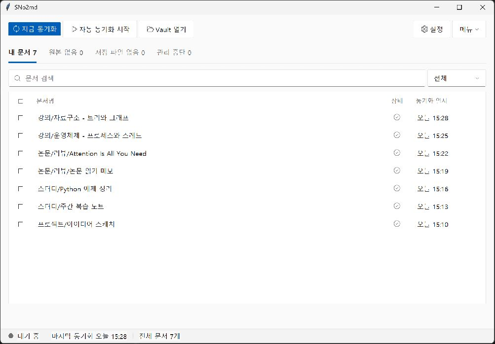
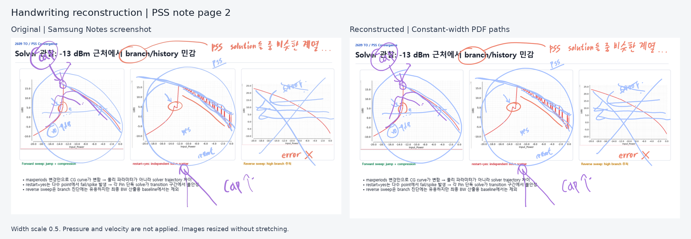

# SNo2md



*예시 문서로 구성한 Windows 앱 메인 화면입니다.*


SNo2md는 삼성노트 백업을 **필기 포함 PDF와 Markdown 한 쌍**으로 변환하는 도구입니다. Windows 앱에서 백업 폴더를 감시해 Obsidian Vault에 변경분을 반영하거나, CLI·Python API로 필요한 노트만 변환할 수 있습니다. Obsidian 없이 일반 폴더에도 저장할 수 있습니다.

[Windows 배포 파일](https://github.com/FalcoAmurensis/SNo2md/releases) · [상세 사용 가이드](USAGE.md) · [문제 제보](https://github.com/FalcoAmurensis/SNo2md/issues)

## 변환 결과 미리보기



왼쪽은 삼성노트 원본, 오른쪽은 변환한 PDF입니다. 원본 PDF 위에 필기의 위치와 색상을 복원합니다. 필압·속도에 따른 굵기 변화는 재현하지 않으며, 기본 선 굵기 배율은 `0.5`입니다. 설정에서 원하는 굵기로 바꿀 수 있습니다.

## 주요 기능

| 기능 | 할 수 있는 일 |
| --- | --- |
| **필기 포함 PDF** | 원본 PDF 배경에 필기와 지원되는 도형·이미지를 합성하고, 지원되는 원본 텍스트의 검색·선택을 유지합니다. |
| **페이지별 Markdown** | 노트 페이지 순서에 맞춰 원본 PDF 본문과 필기 포함 PDF 페이지 링크를 배치합니다. 그림·수식·표는 원본 영역의 이미지로 담습니다. |
| **백업 자동 동기화** | 백업의 변경을 감지해 바뀐 노트를 갱신합니다. 입력 파일이 안정화된 뒤 변환하며, 변경 없는 문서는 건너뜁니다. |
| **제목·폴더 반영** | 백업의 `Storage.sqlite`가 있으면 삼성노트 제목과 분류 폴더를 새 출력 경로에 반영합니다. 가져올 폴더도 선택할 수 있습니다. |
| **사용자 메모 보존** | Markdown의 페이지별 사용자 메모와 문서 끝 사용자 영역을 다음 동기화에도 보존합니다. |
| **충돌 확인·복구** | PDF나 Markdown 생성 영역을 직접 수정하면 갱신을 보류합니다. 수정본 보관, 누락 출력 다시 저장, 관리 중단·재개를 지원합니다. |
| **Windows 앱** | 문서 검색·상태 필터·여러 문서 선택·재시도, 트레이 실행, 로그인 자동 시작, 라이트·다크 테마를 제공합니다. |
| **CLI·Python API** | 노트 하나의 PDF 변환부터 백업 폴더 동기화까지 스크립트에 연결할 수 있습니다. |

### 이런 작업에 활용할 수 있습니다

- **강의 자료 복습:** 필기한 강의 PDF를 Vault에 모으고, Markdown 사용자 메모에 핵심 개념과 복습 내용을 추가합니다.
- **논문 읽기:** 추출한 본문을 검색하며 읽고, 페이지 링크로 필기·도표가 있는 PDF를 함께 확인합니다.
- **노트 아카이브:** 백업 폴더의 변경을 반영해 PDF·Markdown 사본을 유지합니다. 백업에서 사라진 문서의 출력도 남겨 둡니다.
- **검색·LLM 입력 준비:** Markdown과 원본 페이지·필기 획수 메타데이터를 별도 검색·임베딩 파이프라인의 입력으로 사용할 수 있습니다. 검색 서버나 챗봇은 포함되어 있지 않습니다.

## 어떻게 저장되나요?

```text
삼성노트 백업                     저장 폴더 / Obsidian Vault
  노트.sdocx          ───────▶      논문/
  또는 지원되는 노트 폴더              리뷰/
                                      노트 이름/
                                        노트 이름.pdf
                                        노트 이름.md
                                        images/
                                          <이미지 해시>.png
```

PDF에는 필기의 시각적 모습이, Markdown에는 원본 PDF에서 추출한 내용과 직접 작성하는 메모가 들어갑니다. 새 문서는 문서별 폴더에 PDF·Markdown·이미지를 함께 저장합니다. 기본값은 이미지를 `images/`에 무손실 파일로 분리하고 Markdown에서 상대경로로 연결하는 방식입니다. Obsidian과 휴대폰에서 긴 base64 문자열을 처리하는 부담을 줄입니다. 문서를 옮길 때는 문서 폴더 전체를 함께 옮기세요. 설정에서 이미지 내장 방식도 선택할 수 있습니다.

Markdown을 읽을 때의 구성은 다음과 같습니다. 아래는 구조를 설명하기 위한 예시이며, 실제 추출 본문은 원본에 따라 달라집니다.

```markdown
# 노트 이름

## 페이지 1

[필기 포함 PDF 페이지 열기](노트%20이름.pdf#page=1)

### 원본 PDF 내용

원본 PDF에서 추출한 본문…

### 사용자 메모

이 페이지에서 기억할 내용과 다음에 확인할 질문을 작성합니다.
```

실제 파일에는 생성 영역과 사용자 메모를 구분하는 HTML 주석도 들어갑니다. **직접 쓰는 내용은 사용자 메모 영역에 작성하고 경계 주석은 유지하세요.** 이 영역의 공백·개행·코드 블록은 원본이 바뀌어도 보존합니다. 원본에서 삭제된 페이지의 메모도 별도로 남깁니다.

## Windows에서 시작하기

1. [Releases](https://github.com/FalcoAmurensis/SNo2md/releases)에서 Windows ZIP을 받아 전체를 압축 해제합니다. `SNo2md.exe`와 `_internal` 폴더를 함께 보관하세요. Python을 따로 설치할 필요는 없습니다.
2. `SNo2md.exe`를 실행하고 **삼성노트 백업**과 **저장 폴더/Vault**를 선택합니다.
3. **가져올 폴더**를 확인합니다. 기본값은 모든 폴더이며 휴지통은 제외합니다.
4. **저장하고 지금 동기화**를 눌러 현재 문서를 가져옵니다.
5. 이후 백업 변경도 반영하려면 **자동 동기화 시작**을 누릅니다.

처음 설정에서는 **Windows 로그인 시 자동 동기화**가 켜져 있습니다. 원하지 않으면 저장 전에 해제하세요. 앱은 **선택한 백업 파일·폴더의 변경**을 확인합니다.

자동 동기화 중 창의 **X**를 누르면 트레이로 숨깁니다. 완전히 끝내려면 트레이의 **종료**를 사용하세요. 진행 중인 변환·저장을 마친 뒤 종료하므로 긴 문서는 시간이 걸릴 수 있습니다.

폴더 선택, 충돌 해결, 삭제한 출력 다시 만들기, 업데이트 방법은 [상세 사용 가이드](USAGE.md)에 정리되어 있습니다. 배포 ZIP과 현재 소스의 기능은 다를 수 있으므로 사용하는 배포 버전의 안내도 확인하세요.

## CLI와 Python으로 사용하기

Python **3.11 이상**이 필요합니다. 아래는 저장소를 내려받고 프로젝트 루트에 `.venv`를 준비한 Windows PowerShell 환경의 예시입니다. 기본 설치에 PDF·Markdown 변환 엔진이 포함됩니다.

```powershell
# 변환·동기화 기능 설치
.\.venv\Scripts\python.exe -m pip install -e "./src"

# PDF만 생성
.\.venv\Scripts\python.exe -m sno2md "input.sdocx" "output.pdf"

# PDF + Markdown 생성
.\.venv\Scripts\python.exe -m sno2md "input.sdocx" "./vault" --bundle --name "노트 이름"
```

일회성 변환은 기존 파일을 덮어쓰지 않습니다. 새 이름이나 출력 폴더를 지정하세요. 선 굵기는 `--width-scale 0.4`처럼 조정합니다.

### 백업 폴더 자동 동기화

`backup`과 `vault` 폴더를 먼저 만들고 실제 경로로 바꿔 실행하세요.

```powershell
.\.venv\Scripts\python.exe -m sno2md sync setup --backup "./backup" --vault "./vault"
.\.venv\Scripts\python.exe -m sno2md sync run
.\.venv\Scripts\python.exe -m sno2md sync watch
```

`run`은 한 번 동기화하고, `watch`는 변경 감시를 이어갑니다. 감시는 **Ctrl+C**로 종료합니다. 여러 문서를 변환할 때는 `sync run --workers 2`처럼 동시 처리할 노트 수를 지정할 수 있습니다.

### Python API

```python
from sno2md import ConversionOptions, export_note

result = export_note(
    "input.sdocx",
    vault_root="./vault",
    name="노트 이름",
    options=ConversionOptions(width_scale=0.5),
)

print(result.pdf)
print(result.markdown)
```

`convert_pdf(source, destination)`는 PDF만 생성하고, `read_note(source)`는 노트를 해독한 결과를 반환합니다. 소스에서 Windows 앱을 실행하려면 `./src[desktop]`을 설치하고 `.\.venv\Scripts\python.exe -m sno2md.gui`를 실행하세요. CLI 설정과 관리 명령은 [사용 가이드](USAGE.md)를 참고하세요.

## 지원 범위와 알아둘 점

| 항목 | 현재 지원 범위 |
| --- | --- |
| Windows 앱 | Windows 11 x64 |
| Python | Python 3.11 이상 |
| 입력 | `.sdocx`, SDOCX 내부 구조를 갖춘 노트 폴더, 지원되는 노트를 포함한 백업 폴더 |
| 출력 | 필기 포함 PDF, 페이지별 Markdown |
| 저장 위치 | Obsidian Vault 또는 일반 출력 폴더. hard link를 지원하는 파일시스템 필요 |

- **손글씨·스캔 OCR은 지원하지 않습니다.** 손글씨는 PDF에 시각적으로 복원하며 Markdown 본문은 노트에 포함된 원본 PDF에서 추출합니다.
- **삼성노트의 타이핑 본문과 일부 펜·도형·이미지 변형은 미지원입니다.** 지원하지 않는 내용은 오류로 안내할 수 있습니다. `.sdoc`·`.wdoc` 파일 자체를 직접 해독하는 기능도 지원하지 않습니다.
- **표·수식은 의미 복원을 보장하지 않습니다.** 현재 소스는 인식한 그림·수식·표 영역을 이미지로 표시합니다. 대응 구간이 모호하면 추출 원문을 유지하고 경고를 남깁니다. 이미지 내장 옵션은 뷰어의 data URI 지원 여부에 따라 표시가 달라질 수 있습니다.
- **잘라 배치한 PDF도 원본 페이지 전체에서 본문을 추출합니다.** 노트 화면에 보이는 범위와 Markdown 내용이 다를 수 있습니다.
- **기존 출력의 이름·폴더는 자동 이동하지 않습니다.** 삼성노트에서 제목이나 분류를 바꿔도 이미 등록한 파일의 위치는 유지합니다.
- **원본은 읽기만 합니다.** Markdown 생성 영역이나 PDF를 직접 수정하면 충돌로 보류하며, 삭제한 관리 출력은 명시적으로 다시 저장해야 합니다.

변환은 노트 해독 → PDF 합성 → Markdown 추출 → 저장 순서입니다. 긴 문서는 Markdown 추출이 끝날 때까지 출력이 보이지 않을 수 있습니다. 앱의 **메뉴 → 진단 및 로그**에서 상태를 확인할 수 있으며, 운영 로그는 `%LOCALAPPDATA%\SNo2md\desktop.log`에 저장됩니다.

## 라이선스

SNo2md는 [AGPL-3.0-only](LICENSE)로 공개합니다. PDF 합성에는 pypdf, Markdown 추출에는 PyMuPDF 2.0 기반 엔진을 사용합니다. Windows UI는 Tkinter/ttk와 sv-ttk를 사용합니다. 외부 구성 요소의 라이선스 고지는 [`src/third_party/`](src/third_party/)와 배포 ZIP의 `licenses/`에서 확인할 수 있습니다.

EXE 배포 시에는 해당 버전의 소스와 의존성·빌드 자료를 담은 `SNo2md-Source.zip`도 함께 제공합니다.

## Changelog

이 README 업데이트부터 변경 이력을 기록합니다. 배포 전 변경은 **미출시**에 모으고, 배포할 때 버전과 날짜를 붙입니다.

### 미출시

- 동기화 후 미검토 반복 이미지가 있으면 사진 확인 창을 자동으로 엽니다. 숨김·보존 결정을 적용하면 바로 재변환하며, 자동 동기화는 검토 후 재개합니다. 이미 변환한 문서의 미검토 후보도 다음 동기화에서 안내합니다.

### 0.6.6 · 2026-11-03

- 페이지 출처·PDF 배치·필기 획수·삽입 이미지 수 메타데이터를 Markdown JSON 주석에서 AppData 문서 인덱스로 옮겼습니다. Markdown에는 페이지별 필기 획수만 표시하며 PDF 링크와 사용자 메모는 유지합니다.

### 0.6.5 · 2026-11-02

- pHash 임계값 슬라이더의 허용 범위를 0~32로 넓히고 기본값을 8로 변경했습니다. 기존에 저장한 값은 유지합니다.

### 0.6.4 · 2026-11-02

- 반복 로고 등 장식 이미지를 그룹으로 제안하고, 승인한 그룹만 숨기는 검토 창을 추가했습니다. 본문 그림·표·수식은 기본 보존합니다.
- 앞으로 숨길 이미지와 엄격한 pHash 규칙을 로컬에 보관해 다른 문서에도 재사용합니다. 문서별 보존 예외와 숨김 해제를 지원하며 다음 동기화에서 메모를 유지한 채 반영합니다.
- 설정에 pHash 임계값 슬라이더, 안내 버튼, 자동 무시 사진 관리 팝업을 추가했습니다.

### 0.6.3 · 2026-11-02

- 이미지를 별도 파일로 저장하는 방식을 기본값으로 바꾸고 새 문서는 문서별 폴더에 PDF·Markdown·이미지를 함께 저장합니다.
- 설정과 CLI에서 이미지 내장 방식도 선택할 수 있습니다. 관리 이미지의 누락 복구와 수정 충돌 감지를 추가했습니다.

### 0.6.2 · 2026-11-02

- 0.6.2 소스: 원본 PDF·사용자 메모 청크를 AppData에 별도 저장하고, 메모만 수정하면 PDF 재변환 없이 청크를 갱신합니다.
- 설정에 앱 초기화를 추가했습니다. 연결·파일 관리 이력·청크를 비운 뒤 새 동기화의 첫 대상 목록에 대응하는 PDF·Markdown을 덮어쓰고 사용자 메모를 보존합니다.
- 0.6.2 Windows 배포판에 해당 변경을 포함했습니다.

#### 2026-11-02 · 문서

- README를 주요 기능·활용 예시·변환 결과·빠른 시작 중심의 프로젝트 소개로 개편했습니다.
- README 상단에 예시 문서로 구성한 Windows 앱 메인 화면 스크린샷을 추가했습니다.
- 삼성노트 원본과 필기 포함 PDF의 비교 이미지를 배치하고 Markdown 구성 예시를 추가했습니다.
- 상세 조작법을 [사용 가이드](USAGE.md)로 분리하고 GitHub 공개 대상에 포함했습니다.
- README 하단에서 변경 이력 기록을 시작합니다.
