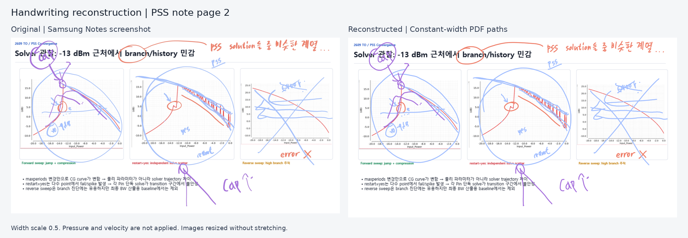
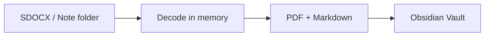

# SNo2md - Samsung note to Markdown/PDF for LLM

삼성노트 백업을 필기 포함 PDF와 Markdown으로 변환하여 Obsidian Vault에 자동 동기화하는 프로그램입니다. 
Windows 앱으로 백업 폴더를 감시하거나, Python 모듈로 필요한 노트만 변환하는 방식 모두 지원합니다.

향후 추출한 자료를 검색·임베딩 도구의 입력으로 활용하는 별도 RAG 프로젝트로 확장합니다. 

처음 사용한다면 아래 **Windows에서 시작하기** 또는 **Python으로 사용하기**를 따르세요.
변환이 오래 걸리면 [처리시간 진단](docs/PERFORMANCE.md), 코드 정리와 개선 우선순위는 [프로젝트 점검 보고서](docs/PROJECT_REVIEW.md)를 참고하세요.

## 주요 기능

- **PDF 변환** — 원본 PDF 배경에 필기·지원되는 도형·이미지를 합성하고, 지원되는 원본 텍스트의 검색·선택 유지
- **Markdown 생성** — 원본 PDF의 제목·본문·표 추출, 페이지 링크, 필기 좌표 메타데이터
- **자동 동기화** — 기존 노트와 새 노트를 가져오고, 백업이 바뀐 문서만 갱신
- **Windows 앱** — 경로 선택, 트레이 실행, 로그인 자동 시작, 문서별 상태·재시도
- **Python 지원** — 터미널 명령과 변환 API 제공

결과는 노트마다 PDF와 Markdown 한 쌍으로 저장됩니다. Vault는 Obsidian에서 사용하는 노트 보관 폴더를 뜻합니다.

```text
Vault/
  논문/
    리뷰/
      노트 이름.pdf
      노트 이름.md
```

### PDF 변환 예시



 필기는 좌표를 연결해 복원하므로 위치와 색상은 유지하지만 필압·속도에 따른 굵기 변화는 반영하기 어려워 그나마 가독성이 좋다고 판단된 굵기 배율 0.5를 기본 적용하였으니, 선호에 맞춰 변경하여 사용하면 됩니다. 

## 지원 환경과 입력

| 항목 | 지원 범위 |
| --- | --- |
| Windows 앱 | Windows 11 x64 |
| Python 모듈 | Python 3.10 이상 |
| 입력 파일 | `.sdocx` 파일 |
| 입력 폴더 | SDOCX를 압축 해제한 것과 같은 내부 구조의 노트 폴더, 또는 이런 노트들을 모아 둔 백업 폴더 |
| 저장 위치 | Obsidian Vault 또는 지정한 출력 폴더. |

출력 파일 게시에는 hard link를 사용하므로 NTFS 등 이를 지원하는 파일시스템이 필요합니다. 네트워크 공유·클라우드 가상 드라이브는 지원 여부를 먼저 확인하세요. Windows 앱은 Windows에서, WSL의 Python 명령은 WSL 환경에서 실행합니다.

`.sdoc`·`.wdoc` 파일 자체를 해독하는 기능은 아직 지원하지 않습니다. 앱 백업에 `Storage.sqlite`가 있으면 문서 제목과 삼성노트의 분류 폴더를 읽어 새 문서의 저장 경로에 반영합니다. PDF·필기는 `wdoc` 안의 노트 파일에서 읽습니다. 삼성노트 백업 폴더를 선택해도 그 안에서 지원하는 노트 구조를 찾을 수 있어야 변환이 가능합니다.

## Windows에서 시작하기

0.6.0은 설정·선택·검색·종료 흐름을 개선하고, 분해형 한글 분류명도 목록에서 완성형으로 표시합니다. 원본 DB·실제 경로·선택 규칙은 변경하지 않습니다.

ZIP에 실행 환경이 포함되어 있어 Python을 따로 설치할 필요는 없습니다.

### 첫 실행

1. ZIP 전체를 원하는 폴더에 풀고 **`SNo2md.exe` 실행**. `_internal` 폴더도 EXE와 함께 보관.
2. 처음 설정 창에서 **삼성노트 백업**과 **저장 폴더/Vault**를 선택. Obsidian Vault와 일반 폴더 모두 사용 가능.
3. **가져올 폴더 선택**에서 범위를 확인. 기본값은 모든 폴더이며 휴지통은 제외.
4. **저장하고 지금 동기화**를 누르면 설정 저장에 성공한 뒤 현재 문서를 한 번 가져옵니다. 취소하거나 저장에 실패하면 동기화를 시작하지 않습니다.
5. 이후 백업 변경도 반영하려면 기본 화면의 **자동 동기화 시작**을 선택합니다.

기본 화면에는 저장한 설정 요약을 표시합니다. **설정 변경**에서 경로와 가져올 폴더를 바꾸고, 접힌 **고급 설정**에서 필기 선 굵기·동시 처리할 노트 수·로그인 자동 시작을 설정합니다. 취소하면 초안을 버리며 경로나 자동 시작 등록을 변경하지 않습니다.

처음에는 **로그인할 때 자동 동기화 시작**이 체크되어 있으며 설정 저장 때 등록됩니다. 원하지 않으면 고급 설정에서 체크를 해제하세요. 이 설정은 현재 세션의 자동 동기화를 시작하는 버튼과 별개입니다.

기본 설정은 **굵기 0.5 · 변경 확인 5초 간격 · 입력 안정화 3초**. 백업 파일의 내용이 일정 시간 바뀌지 않는 것을 확인한 뒤 변환을 시작합니다.

백업·저장 폴더/Vault 경로는 **자동 동기화 중지 → 설정 변경 → 새 경로 선택 → 설정 저장** 순서로 변경할 수 있습니다. 한 번에 한 조합을 동기화하며, 이전 PDF·MD는 이동하거나 삭제하지 않습니다. 동기화 이력은 경로 조합별로 보관하므로 같은 조합으로 돌아오면 이어서 사용할 수 있습니다. 다른 조합은 새로 등록하며, 기존 파일과 이름이 겹치면 충돌로 표시합니다. 굵기와 자동 실행 여부도 변경 가능하며, 기존 CLI 설정이 있다면 그대로 불러옵니다.

### 동기화·재시도·종료

| 작업 | 사용 방법 |
| --- | --- |
| 현재 문서 가져오기 | **지금 동기화**. 변경 없는 문서는 건너뜁니다. |
| 백업 변경 자동 반영 | **자동 동기화 시작/중지**. 삼성노트 앱 자체가 아닌 백업 폴더의 변경을 확인합니다. |
| 실패한 문서 다시 처리 | 문서 선택 → **다시 시도**. 누락 파일 재생성이나 생성 영역 덮어쓰기 권한은 주지 않습니다. |
| 다른 이름으로 저장 | 한 문서 선택 → **다른 이름으로 저장**. 기존 파일은 남고 새 이름이 관리 대상이 됩니다. 기존 사용자 메모의 자동 이전은 하지 않습니다. |
| 문제 확인 | 문서 선택 → **문제 자세히 보기**. 현상과 다음 조치가 먼저 표시되며 원문 오류·경로·로그는 접힌 기술 정보에 있습니다. |
| 프로그램 종료 | 자동 동기화가 꺼져 있으면 **X**로 종료. 작업 중이라면 새 작업을 멈추고 진행 중인 변환·저장을 마친 뒤 종료합니다. 트레이의 **종료**도 같은 종료 경로를 사용합니다. |

**실제로 자동 동기화가 실행 중일 때만 X가 트레이 숨김으로 동작합니다.** 로그인 자동 시작 설정만 켜져 있거나 일회 작업 중인 경우는 정상 종료합니다. 트레이를 사용할 수 없는 자동 동기화 상태에서는 종료 여부를 확인합니다. 트레이에서 자동 동기화를 중지하면 창을 다시 보여줍니다.

설정 저장과 문서 파일을 변경하는 작업은 다른 작업을 멈춘 상태에서 사용합니다. 검색·필터·선택·문제 확인은 실행 중에도 사용할 수 있습니다.

### 가져올 폴더 선택

**설정 변경 → 가져올 폴더 선택**에서 범위를 확인하고 **적용 → 설정 저장**을 누르세요. 처음 저장하는 백업·저장 폴더 조합은 저장 전에 범위를 확인합니다.

- 부모 폴더의 선택은 하위 폴더와 이후 추가되는 문서·폴더에도 적용됩니다. 특정 하위 폴더만 제외할 수도 있습니다.
- 선택하지 않아도 이미 저장한 PDF·Markdown은 삭제하지 않습니다. 다시 포함하면 갱신을 이어갑니다.
- 선택은 백업·저장 폴더 조합별로 보관합니다. 취소한 초안은 저장하지 않습니다.
- 삼성노트 분류 DB가 없으면 파일시스템 폴더 기준으로 표시하며, 단일 SDOCX도 지원합니다.
- 삼성노트에서 문서를 다른 분류로 옮기면 현재 분류의 선택 여부를 따릅니다. 이미 생성한 파일의 위치는 자동으로 옮기지 않습니다.

### 한글 경로 문제 진단

**문제 자세히 보기 → 경로 진단**에서 환경 버전, 정규화 여부, 존재·접근 결과와 실패 단계를 검사할 수 있습니다. 선택한 문서는 임시 사본에서 디코딩까지 확인합니다. 기본 결과에는 개인 경로·문서명·전체 코드포인트를 넣지 않으며, 필요할 때 별도 확인 후 원문을 복사할 수 있습니다.

한글이 분리되어 보이는 현상과 노트 내부 페이지 오류는 별도로 진단합니다. 경로를 일괄 NFC로 바꾸거나 파일을 개명하지 않습니다. 현재 Windows 검증 환경에서 NFC/NFD/혼합 경로의 탐색과 디코딩은 통과했으며, 보고된 다른 PC의 표시·변환 문제 원인은 아직 확정하지 않았습니다.

### 자동 실행과 업데이트

EXE를 직접 실행하면 창이 열리고 자동 동기화 시작을 기다립니다. 로그인 자동 실행은 창을 숨긴 상태로 감시를 시작합니다.

- **자동 실행 해제:** 자동 동기화 중지 → 설정 변경 → 고급 설정에서 로그인 자동 시작 해제 → 설정 저장
- **업데이트:** 트레이에서 종료 → 새 ZIP을 다른 폴더에 풀어 실행
- **EXE 위치 변경:** 설정을 다시 저장해 자동 실행 경로도 갱신
- **삭제:** 자동 실행 해제 → 프로그램 종료 → EXE 폴더 삭제

설정과 동기화 이력은 `%LOCALAPPDATA%\SNo2md`에 보관하므로 EXE 폴더를 교체해도 이어서 사용할 수 있습니다.

### 여러 문서 동시 변환

고급 설정의 **동시 처리할 노트 수**에서 **자동 (권장)** 또는 `1~8`을 선택할 수 있습니다. 각 Worker는 별도 프로세스에서 노트 하나의 PDF·MD를 만들며, 완료한 결과는 순서대로 Vault에 저장합니다. 한 문서 안의 페이지를 나누는 방식은 아닙니다.

`auto`는 CPU와 사용 가능한 메모리를 고려해 최대 2개를 사용합니다. 수동으로 지정해도 메모리가 부족하면 개수를 줄입니다. 변환할 문서가 하나면 Worker도 하나만 사용하고, 배치가 끝나면 프로세스를 종료합니다.

중지를 누르면 새 작업 제출을 멈추고 이미 시작한 변환·저장을 마칩니다. 긴 문서가 실행 중이면 종료까지 시간이 걸릴 수 있습니다. 입력이 계속 바뀌는 경우 ‘지금 동기화’는 안정화를 재확인하며, 누적 대기 5분이 지나면 해당 문서를 대기 상태로 남깁니다.

CLI에서도 같은 설정을 사용합니다.

```bash
sno2md sync settings --workers 2
sno2md sync run --workers 4
```

두 번째 명령은 해당 실행에만 적용됩니다. 기존 입력 내용 해시 검사와 사용자 수정 파일 보호는 그대로 유지됩니다. 성능 로그에는 단계별 시간과 Worker 정보가 기록되며 문서 본문은 기록하지 않습니다.

### 제목과 분류 폴더

새로 등록하는 노트는 삼성노트의 제목을 출력 이름으로 사용합니다. 제목이 비어 있으면 백업 DB의 추천 제목을 사용하며, 같은 폴더에 이름이 겹치면 `(2)` 같은 접미사로 구분합니다. `논문/리뷰` 같은 앱의 폴더 계층도 Vault에 만듭니다. DB가 없는 단일 노트는 읽을 수 있는 제목 또는 입력 이름으로 저장합니다.

SDK 작업 사본인 `LocalState/SPenSDK30`는 탐색에서 제외합니다. DB에서 휴지통으로 분류된 문서는 기본적으로 동기화하지 않습니다. 폴더 선택에서 휴지통을 명시적으로 포함한 경우 새 문서는 `휴지통/` 아래에 저장합니다.

**기존에 등록한 문서의 이름·저장 위치는 자동으로 바꾸지 않습니다.** 이미 생성한 UUID 출력의 이전, 등록 후 제목이나 분류 폴더가 바뀌었을 때의 자동 이동은 후속 작업입니다. 새 경로를 확인하려면 별도 설정·Vault로 처음 등록해 주세요.

## 기존 파일과 충돌 처리

삼성노트 원본은 읽기만 하며, 백업에서 노트가 사라져도 Vault의 PDF·MD는 남겨 둡니다. 백업이 변경되면 프로그램이 생성한 파일을 새 결과로 갱신합니다.

| 상황 | 처리 방식 |
| --- | --- |
| MD 끝의 사용자 영역만 수정 | 바이트 그대로 보존하며 생성 영역만 자동 갱신 |
| MD 생성 영역·frontmatter 또는 PDF 수정 | 갱신을 보류하고 충돌 표시 |
| 생성된 PDF·MD를 삭제 | 저장 폴더/Vault 파일 없음 표시. 명시적으로 다시 저장해야 함 |
| 같은 이름의 다른 파일이 이미 존재 | 덮어쓰지 않고 충돌 표시 |
| 변환·저장 실패 | 이전 결과를 유지하도록 처리하고 오류 표시 |
| 저장 중 프로그램 종료 | 다음 동기화에서 중단된 작업의 복구 시도 |

직접 작성하는 메모는 MD 끝의 **사용자 메모** 영역에 작성하세요. schema 2에서는 frontmatter와 `<!-- sno2md:generated:end -->` 행의 줄바꿈까지가 생성 영역이고 그 뒤 전체가 사용자 영역입니다. 경계 주석을 삭제하거나 복제하지 마세요. 사용자 영역만 편집하면 재변환하지 않으며, 원본 갱신 시에는 현재 메모의 공백·개행·코드 블록까지 그대로 보존합니다.

생성 영역 충돌은 **충돌 해결**에서 **Vault 수정본 보관 후 재개**(기본), **삼성노트 버전 사용**, **나중에 결정** 중 선택합니다. 앞의 두 선택은 식별 가능한 사용자 영역을 유지합니다. 수정된 구형 MD나 경계가 손상된 MD는 전체 보관만 가능하며, 새 MD의 사용자 영역으로 필요한 메모를 직접 옮겨야 합니다. 수정되지 않은 구형 MD는 다음 변환에서 자동 전환됩니다. PDF 변경이나 링크·디렉터리 점유는 이 선택으로 덮어쓸 수 없습니다.

보존본은 같은 폴더의 `<이름>.vault-copy-YYYYMMDD-HHMMSS.md`이며 같은 이름이 있으면 `-2`, `-3`을 붙입니다. 자동 관리·정리하지 않습니다. 결과 창과 상세 화면에서 최근 보존본 위치를 열 수 있습니다. 보존 후 변환이 실패해도 보존본은 남으며, 이후 일반 재시도에 덮어쓰기 허가가 남지 않습니다. 성공하면 자동 관리를 이어가며, 중지한 감시를 임의로 시작하지 않습니다.

복구 충돌이 표시되면 오류에 안내된 파일과 임시 보관본을 남겨 두고 내용을 확인해 주세요. 운영 로그는 `%LOCALAPPDATA%\SNo2md\desktop.log`에 있으며, PDF·Markdown 본문은 기록하지 않습니다.

### 삭제한 관리 출력 다시 만들기

동기화 이력이 있는 PDF·MD가 Vault에서 사라지면 **저장 폴더/Vault 파일 없음** 그룹에서 누락 확장자를 표시합니다. 일반 동기화·재시도·강제 갱신으로는 재생성하지 않습니다. 자동 동기화를 멈춘 뒤 문서를 선택하고 **저장 폴더/Vault에 다시 저장**으로 확인하면 현재 원본으로 PDF·MD를 다시 생성합니다. 과거 파일 복구 기능은 아니며, 원본이 없으면 실행할 수 없습니다.

CLI에서는 `sno2md sync run --restore-missing "입력키"`를 사용합니다. 여러 입력키를 공백으로 구분할 수 있으며 지정한 문서만 처리합니다. 권한은 이번 실행에만 적용됩니다. 폴더 선택에서 제외한 문서는 복원 대상에서도 제외됩니다.

한 파일만 삭제됐어도 남아 있는 파일의 해시를 검사합니다. MD 생성 영역 수정·PDF 변경·경로 점유가 있으면 충돌로 중단하고, 성공 이력은 지우지 않습니다. 변환 중 파일이 다시 생기거나 바뀌어도 중단합니다. 복구 충돌이 발생하면 로그에 표시된 저널과 임시 백업을 보존한 상태로 해결해야 합니다.

### 여러 문서 선택

체크박스와 행 선택은 같은 문서 집합을 가리킵니다. 클릭은 한 문서, Ctrl+클릭은 개별 토글, Shift+클릭은 범위 선택, Ctrl+Shift는 범위 추가입니다. 체크박스·Space는 다른 선택을 유지하며 토글하고 Ctrl+A·체크 열 제목은 보이는 문서를 전체 선택합니다.

문서 작업은 현재 보이는 선택 문서만 사용하며 실행 가능한 개수를 표시합니다. **다시 시도**, **저장 폴더/Vault에 다시 저장**, **Markdown 충돌 해결**, **관리 중단/재개**는 각각의 실행 조건을 따릅니다. **다른 이름으로 저장**은 정확히 한 문서를 선택해야 합니다.

기본 목록은 **동기화 문서**입니다. **백업에서 찾을 수 없음**, **저장 폴더/Vault 파일 없음**, **관리 중단** 그룹으로 전환할 수 있습니다. 문서명·출력 폴더·백업 내 경로 검색과 **전체 / 최신 상태 / 대기·진행 중 / 확인 필요** 필터를 제공합니다. 그룹 수와 검색 결과 수는 별도로 표시합니다. 그룹·검색·필터를 바꾸면 선택을 비우고, 자동 상태 갱신 때는 여전히 보이는 문서의 선택을 유지합니다.

결과 창에는 완료·보류·실패 요약과 스크롤 가능한 목록을 표시합니다. 결과 행을 선택하면 **보존본 열기**, **파일 위치 열기**, **경로 복사**를 사용할 수 있습니다. 작은 창에서는 전체 화면의 세로 스크롤로 아래 작업에 접근할 수 있습니다.

모든 등록 문서에 **관리 중단**을 사용할 수 있습니다. 파일을 삭제하지 않고 성공 이력과 출력 이름 예약을 유지하며, 재시작·재탐색·강제 갱신에서도 자동 변환하지 않습니다. **관리 재개**는 정책과 현재 상태만 검사하며 파일을 만들지 않습니다. 누락 파일을 만들려면 별도로 저장 폴더/Vault에 다시 저장을 실행해야 합니다.

```bash
sno2md sync retire "입력키"
sno2md sync resume "입력키"
sno2md sync resolve "입력키" --choice preserve-vault
# 생성 영역만 원본으로 교체하고 사용자 메모는 보존
sno2md sync resolve "입력키" --choice use-source
# 비대화형 확인 및 누락 출력 생성은 각각 명시
sno2md sync resolve "입력키" --choice preserve-vault --yes --restore-missing
sno2md sync status
```

CLI는 관리 중인 누락·미완료·충돌·오류 문서가 있으면 실패 종료합니다. 관리 중단·폴더 제외 문서는 실패 집계에서 제외하며, 대상 지정 실행은 해당 문서만 집계합니다. `status`는 변환 없이 정책·현재 누락·충돌·최근 보존본 위치를 검사합니다. 백업/Vault 전체가 접근 불가하면 삭제로 판단하지 않고 관찰 미확인으로 표시합니다.

동기화에서 제외된 문서는 일반 목록에 표시하지 않습니다. 관리 중단 그룹은 폴더 제외와 관계없이 조회할 수 있습니다. 기존 파일과 이력은 유지하며, 폴더 선택을 다시 포함하고 동기화하면 목록에 돌아옵니다. 문제 자세히 보기에서 선택한 문서들의 안내와 기술 정보를 볼 수 있습니다. 다른 이름으로 저장은 한 문서씩 사용합니다.

## 변환 품질과 제한 사항

- **페이지 순서:** 삼성노트의 페이지 순서 유지. 빈 배경의 필기 페이지와 끝의 빈 페이지도 포함.
- **텍스트 추출:** PyMuPDF4LLM으로 노트에 들어 있는 원본 PDF에서 추출. 여러 단의 읽기 순서, 표와 수식은 원본과 비교가 필요할 수 있음.
- **손글씨 검색:** 필기는 시각적으로 복원하며, 손글씨를 텍스트로 바꾸는 OCR은 미지원.
- **삼성노트의 타이핑 본문:** 아직 미지원. 일부 펜·도형 스타일과 이미지 자르기·회전도 지원 범위에 제한이 있음.
- **삽입 이미지:** 개수는 페이지 메타데이터에 기록하며, 실제 모습은 연결된 PDF에서 확인. 별도 이미지 파일은 생성하지 않음.

지원하지 않는 내용은 오류로 안내합니다. PDF와 MD를 교체하는 짧은 구간에는 다른 앱에서 두 파일이 서로 다른 버전으로 보일 수 있습니다.

Windows 자동 테스트와 임시 백업·Vault에서 새 ZIP의 PDF·Markdown 생성, 자동 갱신, 트레이 동작을 확인했습니다. Python 경로를 제거하고 번들에 포함된 DLL이 로딩되는지도 점검했습니다. 실제 삼성노트 백업 갱신, Obsidian을 열어 둔 상태의 사용, 실제 로그인 자동 실행, Python이 없는 별도 PC에서의 실행은 추가 확인이 필요합니다.

## Markdown에 담기는 정보

삼성노트의 페이지 순서에 맞춰 **PDF 페이지 링크와 원본 PDF에서 추출한 본문**을 배치합니다. 필기가 있는 빈 페이지도 링크와 메타데이터를 남깁니다. 손글씨와 스캔 이미지의 OCR은 수행하지 않습니다.

각 페이지의 `sno2md:page-meta` HTML 주석에는 검색·임베딩 전처리에서 사용할 정보가 들어 있습니다. 일반 Markdown 미리보기에서는 숨겨집니다.

- 원본 PDF 파일과 페이지 번호, 노트 안의 배치 정보
- 보이는 필기 획수와 각 획을 둘러싼 사각형 좌표
- 삽입 이미지 개수

페이지 번호는 1부터 시작합니다. 필기 좌표는 노트 페이지의 왼쪽 위를 기준으로 너비·높이로 나눈 값이며, 페이지 밖으로 나간 필기는 0~1 범위를 벗어날 수 있습니다. 선의 굵기나 필기의 의미를 분석한 값은 아닙니다.

원본 PDF를 노트 안에서 잘라 배치했더라도 본문은 **원본 PDF 한 페이지 전체**에서 추출합니다. 한 노트 페이지에 PDF가 여러 개 있으면 각각 구분해 담습니다. 중간 자산 폴더나 별도 JSON 파일은 생성하지 않습니다.

Markdown 생성 방식이 바뀐 버전으로 업데이트하면 기존 관리 문서도 다음 동기화에서 다시 생성합니다. MD 사용자 영역은 유지하며, 생성 영역과 PDF의 수정은 충돌로 보호됩니다.

## Python으로 사용하기

프로젝트 루트에서 사용할 Python 환경에 설치합니다. PDF만 필요하면 `python -m pip install ./src`로 설치해도 됩니다. PDF·Markdown 묶음과 동기화에는 `[markdown]` 설치가 필요합니다:

```bash
python -m pip install './src[markdown]'

# PDF 하나 만들기
python -m sno2md input.sdocx output.pdf

# PDF와 Markdown을 함께 만들기
python -m sno2md input.sdocx ./vault --bundle --name '노트 이름'
```

입력은 SDOCX 파일 또는 압축을 푼 노트 하나의 폴더. `--name`을 생략하면 입력 이름을 사용하며, `--width-scale 0.4`처럼 굵기를 지정할 수 있습니다. 일회성 변환은 기존 파일을 덮어쓰지 않으므로 새 이름이나 출력 폴더를 지정하세요.

### 백업 폴더 동기화

아래의 `./backup`과 `./vault`를 실제 백업·출력 폴더 경로로 바꿔 사용하세요. 두 폴더는 설정 전에 만들어져 있어야 합니다.

```bash
python -m sno2md sync setup --backup ./backup --vault ./vault
python -m sno2md sync scan
python -m sno2md sync run
python -m sno2md sync watch
```

`watch` 종료는 **Ctrl+C**. 자주 사용하는 관리 명령은 다음과 같습니다.

| 명령 | 용도 |
| --- | --- |
| `sync locations` | 알려진 백업·Obsidian Vault 경로 확인 |
| `sync status` | 문서별 상태 확인 |
| `sync settings --width-scale 0.4` | 굵기 저장. 다음 동기화에서 다시 생성 |
| `sync run --refresh` | 입력 변경 없이 다시 변환 |
| `sync rename <입력키> <새이름>` | 출력 이름 변경. 기존 파일 유지 |
| `sync rebind <이전입력키> <새입력키>` | 이동한 원본을 기존 출력에 다시 연결 |
| `sync recover` | 중단된 저장 작업 복구 |

입출력 경로는 `sno2md sync settings --backup "새 백업 경로" --vault "새 Vault 경로"`로 변경할 수 있습니다. 둘 중 하나만 지정해도 됩니다.

`입력키`는 `scan`이나 `status`에 표시된 노트 경로입니다. 설정을 바꾸기 전에는 감시를 종료하세요. 일부 문서만 등록하려면 `sync settings --mode manual` 후 `sync add "입력키"`로 선택할 수 있으며, 이미 등록한 문서는 계속 갱신됩니다. 분류 폴더 체크 화면은 GUI에서 제공합니다.

Windows 설정은 `%LOCALAPPDATA%\SNo2md`, Linux의 기본 설정은 `~/.local/state/sno2md`에 저장됩니다. WSL에서 Windows의 백업·Vault 후보를 보려면 `sync locations --windows-profile /mnt/c/Users/<이름>`을 사용하세요.

다른 설정과 분리해 시험하려면 모든 명령에서 같은 `--state-dir`을 **`sync` 뒤, 하위 명령 앞**에 지정하세요. 시험용 `trial-vault` 폴더는 먼저 만들고 별도로 사용합니다.

```bash
python -m sno2md sync --state-dir ./trial-state setup --backup ./backup --vault ./trial-vault
python -m sno2md sync --state-dir ./trial-state run --workers 1
```

### 변환 API

```python
from sno2md import ConversionOptions, export_note

result = export_note(
    'input.sdocx',
    vault_root='./vault',
    name='노트 이름',
    options=ConversionOptions(width_scale=0.5),
)
```

- `export_note(...)`: PDF·Markdown 생성, 출력 경로·처리 개수·경고 반환
- `convert_pdf(source, destination)`: PDF만 생성
- `read_note(source)`: 노트 해독 결과를 메모리에서 사용

### Windows 앱 실행

소스에서 앱을 실행하려면 Windows에서 설치 후 실행:

```powershell
python -m pip install './src[desktop]'
python -m sno2md.gui
```

`sno2md-gui` 명령으로도 실행 가능합니다.

## 변환이 오래 걸리거나 멈춘 것처럼 보일 때

Markdown 엔진의 ONNX 대기 스레드는 기본적으로 **spinning을 사용하지 않습니다**. 별도 설정은 필요 없으며, 동시 변환 문서 수와 모델 내부 스레드 수는 기존 정책을 유지합니다.

PDF·MD 묶음은 **해독 → PDF 합성 → 원본 PDF의 Markdown 추출 → 저장** 순서로 처리합니다. PDF 합성이 끝나도 Markdown이 완성될 때까지 Vault에 결과가 나타나지 않습니다. OCR은 꺼져 있지만 문서 레이아웃 분석은 수행합니다.

- **대기 상태:** 처음 관측한 입력은 안정화 시간을 기다립니다. 기본값 기준 한 번 동기화는 약 3초 뒤, 감시는 다음 폴링(기본 5초)에서 다시 확인합니다. 실제 대기에는 탐색·해시 검사 시간도 더해집니다.
- **변환 중:** 한 문서는 Worker 하나에서 처리합니다. 동시 변환 수를 늘려도 문서 하나의 페이지가 병렬 처리되지는 않습니다. GUI의 CPU 수치뿐 아니라 자식 프로세스도 확인하세요.
- **원인 확인:** `desktop.log`의 `pool:`, `conversion:`, `timing:` 기록을 확인합니다. `conversion:`은 변환 완료 후 남으므로 실행 중 기록이 없다는 이유만으로 멈췄다고 판단할 수 없습니다.
- **PDF만 급히 필요:** Python의 PDF 전용 명령을 사용하면 Markdown 추출을 생략합니다. GUI 동기화에는 PDF 전용 옵션이 없습니다.

RAM 약 500 MB라는 관측만으로 메모리 부족이나 CPU 미사용을 확정할 수 없습니다. [처리시간 진단과 측정 예제](docs/PERFORMANCE.md)에 단계별 해석과 현재 측정 범위를 정리했습니다.

## 동작 구조와 확장



SDOCX는 페이지 정보와 원본 PDF·이미지 등을 ZIP 형태로 묶은 파일입니다. 한 번 해독한 페이지 정보로 필기와 배경을 합성해 PDF를 만들고, 메모리에 보관한 원본 PDF에서 별도로 Markdown을 추출합니다. 앱과 CLI, Python API가 이 변환 모듈을 함께 사용하며, 별도 자산 저장소는 두지 않습니다.


PDF 합성에는 pypdf, Markdown 추출에는 PyMuPDF4LLM·PyMuPDF·PyMuPDF Layout 1.28.2를 사용합니다. Windows 앱은 Tkinter/ttk와 pywin32로 구성됩니다.

## 라이선스와 소스 배포

SNo2md는 [AGPL-3.0-only](LICENSE)로 공개합니다. 포함된 외부 구성 요소에는 각자의 라이선스가 적용되며, 고지는 [`src/third_party/`](src/third_party/)와 배포 ZIP의 `licenses/`에서 확인할 수 있습니다.

EXE를 배포할 때는 같은 다운로드 위치에 `SNo2md-Source.zip`도 함께 제공합니다. 소스 ZIP에는 해당 버전의 프로그램, 빌드 스크립트, 고정 의존성 목록과 AGPL 구성 요소의 소스가 포함됩니다. 개인 노트·변환 결과·운영 설정은 포함하지 않습니다.
