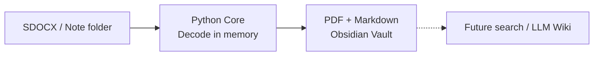
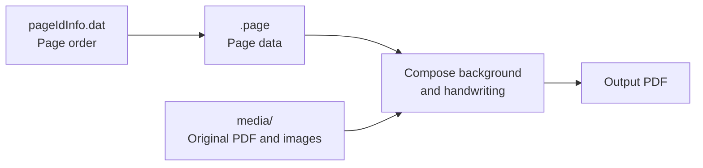

# SNo2md - Convert Samsung note to markdown for LLM 

삼성노트의 **백업 폴더**를 읽어 향후 LLM이 사용할수 있도록 PDF 및 마크다운으로 변환한다. 

현재 Phase 2까지 구현된 상태. 단일 PDF 변환 스크립트를 설치 가능한 Python 모듈로 분리하고, 노트를 한 번 해독해 메모리에 두고 PDF·Markdown을 생성한다. 중간 자산 저장소는 만들지 않는다. CLI와 다른 Python 프로그램이 같은 Core를 호출한다.
향후 별개의 RAG 프로젝트로 확장한다. 

| 단계 | 상태 | 범위 |
| --- | --- | --- |
| Phase 1 | 구현 | Core 모듈화, Python API, CLI, 기존 PDF 변환 유지 |
| Phase 2 | 구현 | 페이지별 Markdown, PDF·MD 묶음 출력 |
| Phase 3 | 예정 | 실제 Windows 백업 확인, 변경 감지, Vault 자동 갱신 |
| Phase 4 | 예정 | Windows 앱 배포 |

## 설계: 변환 Core와 활용 계층 분리

Obsidian 자동 연동에 사용할 변환기를 독립적으로 호출할 수 있는 Python 패키지로 구성했다. 
PDF 렌더링과 Markdown 작성이 메모리의 같은 페이지·객체 정보를 공유한다. 감시·GUI·임베딩은 이 Core를 이용하는 후속 계층으로 둔다.



Vault에는 **PDF와 생성 MD만** 넣는다. 개인 메모는 별도 파일로 관리하며 프로그램이 수정하지 않는다. JSON·이미지·원시 필기 배열을 별도로 내보내지 않는다. 후속 검색 프로그램은 PDF·MD를 읽으며, 필요한 이미지 영역은 PDF에서 추출하거나 렌더링한다. 변환 옵션이나 해독 방식이 바뀌면 삼성노트 원본 백업을 다시 읽어 생성한다.

## What's in SDOCX 

```text
note.sdocx (ZIP-like archive)
├── note.note              # 노트 메타데이터, 제목·본문 객체
├── pageIdInfo.dat         # 노트의 페이지 ID와 실제 순서
├── <page-id>.page         # 페이지 크기, PDF 참조, 레이어와 객체
├── end_tag.bin            # 종료·검사 관련 메타데이터
└── media/
    ├── mediaInfo.dat      # 숫자 ID와 미디어 파일명의 연결 표
    ├── 0@....pdf          # 가져온 원본 PDF
    ├── 3@....png          # 삽입 이미지
    └── ...spi             # 렌더링 캐시 데이터
```

노트의 페이지와 미디어 파일은 다음 관계로 연결했다.



**필기를 가져오기 위해서는 `.page` 안의 레이어와 object를 읽어야 한다.** 
원본 PDF는 `media/`에 보관되고, 그 위에 추가한 필기는 `.page`에 좌표·색상·굵기 등의 데이터로 따로 저장되는 구조이므로 `pageIdInfo.dat` 순서대로 `.page`를 읽고, 필기 좌표를 복원해 출력 페이지에 그리는 방식으로 구현했다.


## Converter 

1. **구조 해독:** 파일을 읽어 페이지 순서, 배경 PDF 연결, 레이어와 객체를 복원한다. 
2. **필기 복원:** 각 획의 첫 좌표와 압축된 좌표 변화량 데이터를 해독해 점들을 얻는다. 압력·원시 시간·기울기 등의 해독값은 변환 중 메모리에만 두며, 현재 렌더링은 필압·속도에 따른 굵기 변화를 적용하지 않는 근사 복원이다. 

   

   

   왼쪽은 실제 삼성노트 스크린샷, 오른쪽은 변환 PDF의 같은 슬라이드 영역이다. 필기 위치와 색상은 대응하지만 필압/가속도를 반영하지 않은 복원본은 선이 더 두껍고 균일하게 보임을 반영해 pdf 변환시 굵기 배율을 0.5로 조정함. 이때 배율 1.0보다 작은 글씨의 뭉침이 줄고 원본의 가는 선에 가까워졌다. 현재 CLI의 `--width-scale` 또는 Python 옵션으로 조정할 수 있으며, 노트별 설정 저장은 후속 작업이다.


3. **도형·이미지 복원:** 지원하는 도형의 직선·곡선을 PDF 경로로 만들고, 삽입 PNG를 위치와 투명도에 맞춰 배치한다.
4. **PDF 합성:** `pypdf`가 원본 PDF의 회전·크기·배치를 맞추고 필기 객체를 올린다. 텍스트와 폰트 리소스를 유지하며 전체 페이지를 이미지로 바꾸지 않는다.
5. **출력 저장:** 모든 페이지를 처리한 뒤 새 PDF를 저장한다. 미지원 내용은 오류로 중단하고, 기존 파일은 덮어쓰지 않는다. 끝의 빈 페이지도 임의로 제거하지 않는다.

## 입출력 동작

### 입력

- **`.sdocx` 파일:** ZIP 형태의 컨테이너에서 페이지·미디어·필기를 읽는다.
- **압축 해제된 노트 폴더:** 같은 내부 구조를 가진 노트 루트 하나를 전달한다.
- 입력 원본은 수정하지 않는다. 실제 Windows 백업 전체에서 노트를 발견하거나 SQLite를 해석하는 기능은 아직 구현하지 않았다.

### 출력

| 출력 | 내용과 역할 |
| --- | --- |
| PDF | 원본 PDF 배경 위에 필기·도형·이미지를 합성. 지원되는 배경 텍스트와 폰트 리소스 보존 |
| Markdown | 노트 제목, 페이지 구분, 합성 PDF 페이지 링크, 필기 획수, 삽입 이미지 참조, 추출 텍스트 |

출력 순서는 원본 PDF 순서가 아닌 `pageIdInfo.dat`의 **노트 페이지 순서**다. PDF 배경이 없는 필기 페이지와 끝의 빈 페이지도 유지한다. Markdown 텍스트는 합성 PDF를 다시 읽지 않고 **내장 원본 PDF에서 추출**해 노트 페이지에 연결한다.

Markdown은 추출 텍스트를 `text` 코드 블록에 보존한다. 페이지별 필기 획수와 이미지 링크를 향후 LLM이 활용할 수 있는 메타데이터로 남겨둔다. 이미지 링크는 합성 PDF의 해당 페이지를 가리킨다. 텍스트 없는 페이지도 제목·PDF 링크를 유지한다.

```text
Vault/
  노트 이름.pdf
  노트 이름.md
```

필기의 획별 원시 정보와 원본 객체 구분은 출력에 별도로 보존하지 않는다. PDF에는 근사 복원된 시각 정보가, MD에는 추출 텍스트와 페이지 참조가 남는다.

### 저장과 실패 처리

- **PDF 전용:** 새 PDF 하나를 생성한다. **묶음 출력:** 한 번 해독해 PDF·MD 두 파일을 생성한다.
- 출력 폴더는 이미 있어도 되지만 대상 PDF·MD는 새 경로여야 한다. 현재는 기존 파일을 덮어쓰지 않는다. 변경 감지에 따른 자동 교체는 Phase 3에서 구현한다.
- 입력 노트 폴더 안에는 출력하지 않는다. 개인 메모는 수정하지 않는다.
- PDF·MD를 임시 파일로 모두 작성한 뒤 게시한다. 임시 출력 파일은 중간 자산 저장소가 아니며 정상 종료 시 제거된다.
- 처리 가능한 저장 오류에서는 이번 호출이 만든 결과를 되돌린다. 미지원 내용·텍스트 추출 오류는 빈 결과로 숨기지 않고 실패시킨다.
- 현재 게시 방식은 hard link를 지원하는 파일시스템이 필요하다. 두 파일의 게시가 하나의 원자 연산은 아니므로, 강제 종료 복구와 후속 인덱서의 변경 감지 조정은 후속 단계에서 다룬다. `ready.json`은 생성하지 않는다.

## 설치와 실행

Python 3.9 이상. 프로젝트 루트에서 PDF·Markdown 기능을 함께 설치한다.

```bash
python3 -m venv .venv
.venv/bin/python -m pip install -e './src[markdown]'

# PDF만 생성 (기존 호출 유지)
.venv/bin/python src/convert_sdocx.py input.sdocx output.pdf

# PDF + MD만 Vault에 저장
.venv/bin/sno2md input.sdocx /path/to/vault --bundle \
  --name '노트 이름'
```

`--width-scale`의 기본값은 0.5다. ZIP 대신 압축 해제된 노트 폴더도 입력할 수 있다. 대상 PDF·MD는 새 경로여야 한다. `--name`을 생략하면 입력 파일/폴더 이름을 사용한다.

```python
from sno2md import export_note, ConversionOptions

result = export_note(
    'input.sdocx', vault_root='/path/to/vault',
    name='노트 이름',
    options=ConversionOptions(width_scale=0.5),
)
```

`convert_pdf(source, destination)`는 PDF 전용, `export_note(...)`는 묶음 출력 API다. 반환값 `ConversionResult`에서 출력 경로·처리 개수·경고를 확인할 수 있다. 해독만 필요한 경우 `read_note(source)`를 호출한다. CLI는 `python -m sno2md`로도 실행할 수 있다.

핵심 소스는 `src/sno2md/`의 해독·PDF·Markdown·작업 조정 모듈로 나뉜다. CLI와 API가 같은 Core를 호출한다. 과거 연구 도구는 `src/research/`에 분리되어 있다.

PDF 전용 설치는 `pip install ./src`이며 추가 의존성은 pypdf다. `[markdown]` 선택 설치는 CFF 폰트의 텍스트 해독을 위해 fontTools를 추가한다. PyMuPDF·Pillow·외부 SDOCX 파서는 Core에 필요 없다. 라이선스 고지는 `src/third_party/`에 보존했다.

로컬 개발문서: [실행 안내](docs/USAGE.md) · [Phase 1·2 구현 기록](docs/11_core_markdown_implementation.md). `docs/`는 개발 환경에서만 보관하므로 GitHub 배포본에는 없을 수 있다.

## 확인 범위와 현재 한계

외부 데이터 출력 제거 전 Phase 1·2 구현 시 JSSC·MSD·PSS 세 샘플의 **총 72페이지**를 변환하고 PDF·MD·메타데이터의 페이지 대응을 확인했다. 출력 PDF와 메타데이터의 추출 텍스트는 공백을 제외하고 일치했으며, PSS 9페이지는 기존 굵기 0.5 출력과 같은 배율로 렌더링한 픽셀이 일치했다. 최근 Markdown 템플릿 변경 후에는 PSS를 다시 변환했다.

- 비공백 삼성노트 타이핑 본문, 미확인 펜·도형 스타일, 일부 이미지 크롭·회전 등은 미지원이며 오류로 중단한다.
- 필기는 좌표 기반 근사 복원이다. OCR·필기 의미 해석·Figure 판별은 하지 않는다.
- PDF 텍스트의 다단 읽기 순서·표·절 구조는 복원하지 않는다. 후속 임베딩 단계에서 청킹과 전처리가 필요하다.
- 실제 Windows 백업 감시, Obsidian 링크 클릭, EXE 배포 검증은 아직 남아 있다.

## 확장 방향

### Phase 3 — Windows 백업 → Vault 자동 갱신

실제 백업에서 노트 루트와 파일 쓰기 순서를 먼저 확인한다. 이후 자동 등록 또는 수동 선택으로 관리할 노트를 정하고, 변경 감지 → 안정된 작업 사본 확보 → Core 변환 → PDF·MD 갱신으로 연결한다.

등록된 생성물만 갱신하며 개인 메모는 별도로 유지한다. 사용자가 생성 MD나 PDF를 직접 수정했다면 자동 교체를 보류하도록 설계할 예정이다. 잠금·실패 시 이전 성공본을 보존하고, 여러 파일을 교체하다 중단된 경우를 복구하는 작업 기록도 이 단계에서 추가한다. 원본 삭제를 Vault 파일의 자동 삭제로 연결하지 않는다.

### Phase 4 — Windows 앱·EXE

백업·Vault 경로, 최초 등록 방식, 필기 굵기, 처리 상태·재시도를 설정하는 앱을 만들고 Python 개발 환경 없이 실행할 수 있는 EXE로 배포한다. GUI와 감시 계층도 현재 Python API를 호출하도록 구성한다.

### 후속 검색 프로젝트 — 임베딩·MCP·LLM Wiki

별도 소비자가 PDF·MD를 읽어 텍스트 전처리·청킹, 필요한 이미지/Figure 영역 추출·렌더링, 임베딩과 검색을 수행하도록 확장한다. MD의 페이지 링크로 검색 결과를 합성 PDF에 연결한다. 필기와 배경 그래픽을 객체 수준에서 구분하는 정보는 별도 저장하지 않으므로, 필요한 경우 후속 분석에서 다룬다. 


OHS, EmbeddingGemma 2, MCP는 연동 후보이며 구체적인 모델·입력 모달리티·API는 해당 단계에서 확인한다. 임베딩 모델은 변환기의 실행 의존성에 넣지 않는다. 최종적으로 검색 결과의 원본 페이지를 추적하면서 지식을 비교·연결하는 개인용 **LLM Wiki**를 목표로 한다.

PDF·MD만으로 열람과 후속 검색의 입력을 전달한다. 향후 감시 기능에 필요한 입력·출력 연결과 마지막 처리 상태는 별도의 작은 운영 상태로 관리하되, 자산 저장소는 만들지 않는다. PDF++ 등으로 수정한 PDF의 주석 보존·충돌 병합은 추가 백로그로 남긴다.
