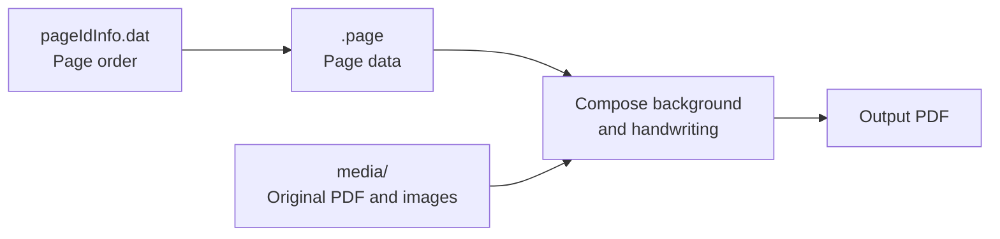

# SNo2md - Convert Samsung note to markdown for LLM 

삼성노트의 **SDOCX 파일 또는 압축 해제된 노트 폴더**를 읽어 필기·도형·삽입 이미지를 포함한 PDF 및 마크다운으로 변환한다. 

현재는 **노트 하나 전체를 PDF 변환하는 CLI**까지 구현했다. 최종 목표는 Windows의 삼성노트 백업을 감시하고 Obsidian Vault의 PDF를 자동 갱신하는 것이다.
(본래 삼성노트->옵시디언 자동 handoff 파이프라인으로 설계했으나, 확장의 여지를 남기기 위해 일단은 간단한 버전만)

## What's in SDOCX 

```text
note.sdocx (ZIP-like archive)
├── note.note              # 노트 메타데이터, 제목·본문 객체
├── pageIdInfo.dat         # 노트의 페이지 ID와 실제 순서
├── <page-id>.page         # 페이지 크기, PDF 참조, 레이어와 객체
├── end_tag.bin            # 종료·검사 관련 메타데이터
└── media/
    ├── mediaInfo.dat      # 숫자 ID와 미디어 파일명의 연결 표
    ├── 0@....pdf          # 가져온 원본 PDF
    ├── 3@....png          # 삽입 이미지
    └── ...spi             # 렌더링 캐시 데이터
```

노트의 페이지와 미디어 파일은 다음 관계로 연결했다.



**필기를 가져오기 위해서는 `.page` 안의 레이어와 object를 읽어야 한다.** 
원본 PDF는 `media/`에 보관되고, 그 위에 추가한 필기는 `.page`에 좌표·색상·굵기 등의 데이터로 따로 저장되는 구조이므로 `pageIdInfo.dat` 순서대로 `.page`를 읽고, 필기 좌표를 복원해 출력 페이지에 그리는 방식으로 구현했다.


## Converter 

1. **구조 해독:** 파일을 읽어 페이지 순서, 배경 PDF 연결, 레이어와 객체를 복원한다. 
2. **필기 복원:** 각 획의 첫 좌표와 압축된 좌표 변화량 데이터를 해독해 점들을 얻는다. 압력·속도 데이터가 존재하여 실제의 필기에 가까운 세밀한 펜 표현 또한 복원이 **이론상** 가능하지만, 이를 역설계하면 배꼽이 더 커지기에 생략한다. 

   

   

   왼쪽은 실제 삼성노트 스크린샷, 오른쪽은 변환 PDF의 같은 슬라이드 영역이다. 필기 위치와 색상은 대응하지만 필압/가속도를 반영하지 않은 복원본은 선이 더 두껍고 균일하게 보임을 반영해 pdf 변환시 굵기 배율을 0.5로 조정함. 이때 배율 1.0보다 작은 글씨의 뭉침이 줄고 원본의 가는 선에 가까워졌다. 이후 사용자가 조정할수 있도록 만들 계획. (필기 역설계할게 아니라면)


3. **도형·이미지 복원:** 지원하는 도형의 직선·곡선을 PDF 경로로 만들고, 삽입 PNG를 위치와 투명도에 맞춰 배치한다.
4. **PDF 합성:** `pypdf`가 원본 PDF의 회전·크기·배치를 맞추고 필기 객체를 올린다. 텍스트와 폰트 리소스를 유지하며 전체 페이지를 이미지로 바꾸지 않는다.
5. **출력 저장:** 모든 페이지를 처리한 뒤 새 PDF를 저장한다. 미지원 내용은 오류로 중단하고, 기존 파일은 덮어쓰지 않는다. 끝의 빈 페이지도 임의로 제거하지 않는다.

## 소스 구성과 실행

```text
src/
├── convert_sdocx.py       # CLI, 도형·이미지 처리, 전체 PDF 합성·저장
├── inspect_sdocx.py       # ZIP/폴더 읽기, 바이너리 구조·필기 해독
├── render_strokes_svg.py # 필기만 SVG로 만드는 연구 도구
├── requirements.txt      # 변환기 의존성: pypdf
├── research/             # 과거 분석·비교 그림 도구 (변환 실행에 불필요)
└── third_party/           # 의존성 라이선스 고지
```

Python 3.9 이상에서 프로젝트 루트를 기준으로 실행한다.

```bash
python3 -m venv .venv
.venv/bin/python -m pip install -r src/requirements.txt
.venv/bin/python src/convert_sdocx.py input.sdocx output.pdf
```

첫 번째 인수에 압축 해제된 노트 폴더를 넣어도 된다. `--width-scale 0.5`로 필기·도형의 선 굵기 배율을 지정할 수 있으며 기본값은 0.5이다. Windows 명령과 자세한 사용법은 [실행 안내](USAGE.md)를 참고한다.

**변환기의 추가 의존성은 pypdf뿐이다.** Dietrich·sdocx_parser는 초기 연구에, PyMuPDF·Pillow는 기존 비교 그림 제작에 사용했지만 최종 변환기에는 필요 없다. pypdf의 라이선스 고지는 [소스에 포함](../src/third_party/pypdf-LICENSE.txt)했다.

## 현재 제한과 다음 단계

- **비공백 타이핑 본문, 미확인 펜·도형 스타일, 이미지 크롭·회전 등은 아직 제한된다.** 지원하지 않는 내용이 생기면 변환을 중단한다.
- **다음 단계:** Windows 백업의 노트 발견·등록 → 변경 감지 → 안정된 사본 변환 → Vault PDF의 안전한 갱신. 현재 CLI에는 감시·자동 교체 기능이 없다.
