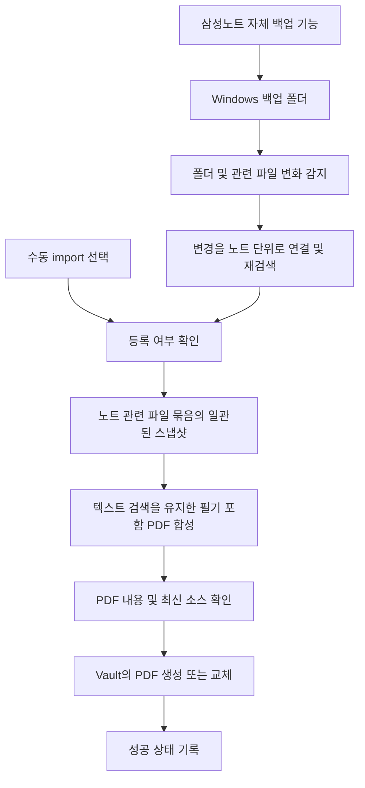

# Samsung Notes → Obsidian 필기 포함 PDF 연동 계획

갱신일: 2026-10-14 · 상태: 사용자 선택 반영 / 실제 폴더 구조·갱신 규칙 확인 전 / 새 파이프라인 구현 전

관련 문서: [문서 안내](README.md) · [백로그](02_backlog.md) · [검증 계획](03_verification.md) · [기존 구조 조사](05_structure_research.md)

## 1. 목표와 확정된 흐름

삼성노트 자체 기능으로 Windows에 저장되는 폴더형 백업을 입력으로 삼는다. 사용자 확인에 따르면 백업에는 `sdoc`, `wdoc`, SQLite 등이 있으며, 노트 데이터는 ZIP으로 묶인 `.sdocx` 대신 폴더 형태로 존재한다. 프로그램은 Windows에서 직접 실행하며, 지정 백업 루트 아래의 변화를 노트 단위로 모아 해당 노트 전체를 필기 포함 PDF로 변환한다. 출력은 원래 PDF의 텍스트 검색·선택을 유지하고 Obsidian Vault의 지정 경로에 저장한다.

최초 등록은 자동 등록 또는 수동 선택 등록 중 고를 수 있고, 등록 이후에는 두 모드 모두 자동 갱신한다. 실제 백업을 만드는 과정은 삼성노트가 담당하고 이 프로그램의 책임은 백업 폴더 이후부터다. 같은 경로의 내용이 갱신된다는 것은 현재 사용자의 추정이며, 실제 재백업 전후를 관측해 확인해야 한다. 새 폴더형 입력의 구조가 기존 SDOCX 추출물과 완전히 같거나 기존 파서가 그대로 읽을 수 있다는 점은 아직 검증하지 않았다.



## 2. 이전 계획에서 바뀐 범위

| 항목 | 현재 계획 |
| --- | --- |
| 생성 단위 | 식별된 노트 데이터 묶음 하나에 출력 PDF 하나. SQLite/미디어 파일별 PDF를 만들지 않음 |
| 출력 내용 | PDF 배경, 필기, 도형, 삽입 이미지, 노트 텍스트를 포함한 노트 페이지 전체 |
| 페이지 순서 | 삼성노트의 실제 페이지 순서. 원본 PDF에 없는 노트 페이지도 포함 |
| 갱신 단위 | 변경된 노트 전체 재변환. 첫 버전에 페이지별 증분 합성은 요구하지 않음 |
| 백업 생산자 | 삼성노트 자체 기능. snotebackup 서비스 구축은 현 범위 밖 |
| 실행 계기 | 백업 폴더 안의 관련 파일 변화. 시작/재연결 시 놓친 변경 재검색 |
| 최초 등록 | 자동 등록 또는 수동 선택 등록. 등록 후에는 둘 다 자동 갱신 |
| 실행 환경 | Windows 직접 실행 |
| PDF 텍스트 | 원래 PDF의 검색·선택 유지 필수 |
| 생성 PDF 소유 | 열람용 생성 사본. 등록된 출력은 같은 경로에 자동 교체 |
| Obsidian 연결 | Vault의 파일을 직접 작성. 기기간 동기화는 기존 Vault 동기화 수단에 맡김 |
| AI/OCR | 외부 AI API와 OCR을 기본 파이프라인에 사용하지 않음 |

자동 인용 추출, 표시별 정답 라벨, Markdown 생성 영역/수동 확인 영역, 인용과 메모 대응은 현재 첫 버전의 요구사항에서 제외한다. 최소 50개 표시·90% 인용 성공률 기준도 새 PDF 변환의 선행 조건이 아니다. 관련 과거 문서는 [보관본](archive/annotation_pipeline/01_plan.md)에 남긴다.

## 3. 확정된 선택과 관측할 사항

| ID | 항목 | 사용자 답변과 적용 |
| --- | --- | --- |
| Q1 | 입력 형식·갱신 방식 | `sdoc`/`wdoc`/SQLite 등을 포함한 폴더형 백업. 같은 경로 갱신으로 추정하되 실제 확인 필요 |
| Q2 | PDF 텍스트 | 원래 PDF의 검색·선택을 유지해야 함 |
| Q3 | 등록 모드 | 자동 등록 / 수동 선택 등록 제공, 등록 후 공통 자동 갱신 |
| Q4 | 생성 PDF 직접 수정 | 현재는 열람용 사본으로 자동 교체. 향후 PDF++ 등을 통한 수정·충돌 대응은 백로그 |
| Q5 | 실행 환경 | Windows 직접 실행 |

현재 남은 것은 선택 질문의 재확인이 아니라 다음 기술 관측이다.

- 실제 백업 루트와 `sdoc`/`wdoc`/SQLite의 역할, 노트별 하위 경로와 참조 자산 범위.
- 같은 노트를 재백업할 때 유지되는 경로/식별자와 생성·수정·교체 순서.
- SQLite가 노트 목록/제목/경로/수정 상태 연결에 필요한지, 노트 폴더만으로 식별 가능한지.
- 백업/Vault 경로, 삼성노트 버전, 접근 권한과 잠금 동작.

SQLite 스키마나 테이블명은 실제 파일을 확인하기 전 임의로 정하지 않는다. `.sdocx`용 연구 결과는 재사용 후보이며 폴더형 백업의 검증 증거를 대신하지 않는다.

## 4. 등록 모드

- 자동 등록: 지정 백업 범위에서 발견한 노트 단위를 자동 등록한다. 최초 실행 때 이미 있는 노트도 같은 정책으로 처리한다.
- 선택 등록: 발견된 노트 목록에서 사용자가 import 대상으로 선택한 노트만 등록한다. 미등록 노트의 파일 이벤트로 PDF를 만들지 않는다.
- 등록 완료 후에는 두 모드 모두 노트 관련 데이터 변경을 감지해 자동 갱신한다.
- 모드를 바꿔도 기존 등록이나 출력 PDF를 삭제하지 않는다.

수동 import는 개별 SQLite/페이지/미디어 파일을 PDF로 바꾸는 동작이 아니라, 감시 범위에서 노트 데이터 묶음을 선택해 소스와 출력의 연결을 등록하는 동작이다. 사용자가 선택할 화면이나 CLI의 형태는 구현 단계에서 정한다. 감시 폴더 밖의 독립 입력을 일회성 변환하는 기능은 별도 백로그로 둔다. 같은 노트를 다시 import해도 두 번째 PDF를 만들지 않는다.

## 5. 폴더 변화 감지와 처리 순서

1. 시작 시 백업 루트를 검색해 노트와 관련 파일의 연결을 구성하고 등록 상태와 대조한다. 실행 중에는 하위 파일/폴더의 생성·수정·이름 변경을 감지한다.
2. 이벤트를 노트 단위로 묶는다. 페이지/미디어 변경은 소유 노트를 대상으로 하고, 공유 SQLite 변경처럼 영향 노트를 즉시 알 수 없으면 목록/참조 관계를 재검색한다. DB 이벤트 하나마다 모든 PDF를 무조건 재생성하지 않는다.
3. 노트의 관련 파일 목록과 크기/수정 시각이 안정되는지 확인한다. 파일들이 순차적으로 쓰이거나 잠겨 있으면 기다린 뒤 다시 시도한다. 안정 대기 시간은 실제 백업 관측으로 정한다.
4. 해당 노트에 필요한 메타데이터·페이지·자산 묶음을 작업 폴더에 복사한다. 복사 전후 파일 목록과 변경 여부를 확인하고 참조 파일/페이지가 읽히는지 검사한다. 공유 자산도 의존 범위에 포함한다. 일정 시간 변화가 없었다는 사실만으로 여러 파일이 같은 버전이라고 단정하지 않는다. 필요한 버전/참조 일관성을 확인할 수 없으면 보류한다.
5. SQLite 정보가 필요하면 읽기 전용으로 일관된 조회/스냅샷을 얻는다. 쓰는 중인 DB 본체만 단순 복사해 완전한 상태로 간주하지 않는다. WAL 등 동반 파일 사용 여부와 적절한 스냅샷 방법은 실제 DB를 확인해 정하며 원본에 쓰거나 강제 checkpoint하지 않는다.
6. 마지막 성공 시점과 관련 입력 내용이 같으면 PDF를 다시 쓰지 않는다. 변경 판정용 해시는 노트 식별자가 아니다. 안정된 스냅샷으로 해당 노트 전체를 임시 PDF에 합성한다.
7. 임시 PDF의 열기/페이지/객체/텍스트 보존 상태를 확인한다. 변환 도중 입력 묶음이 바뀌면 최신 변경을 큐에 남기고 오래된 결과로 현재 출력을 교체하지 않는다.
8. 등록된 생성 PDF를 같은 경로에 교체한다. 출력과 같은 파일시스템의 임시 파일을 사용하며 Windows PDF 열람/동기화 프로그램의 잠금 때문에 실패하면 기존 PDF를 유지하고 재시도한다.
9. 실제 출력 반영이 끝난 뒤에만 성공 입력 상태와 출력 상태를 기록한다.

같은 노트의 변환과 교체가 동시에 실행되지 않게 한다. 폴더가 일시 접근 불가이면 삭제로 판정하지 않는다. 시작/재연결 재검색으로 누락 이벤트를 보완하며 보조 주기 재검색 간격은 실제 감시 방식 검증 후 정한다. 이전의 30분 실행을 현재 기본 요구사항으로 유지하지 않는다.

## 6. 식별과 출력 경로

기존 연구 샘플에서는 신뢰할 노트 UUID를 확보하지 못했다. 따라서 UUID가 반드시 존재한다고 설계하지 않는다.

- 같은 경로 갱신을 작업 가정으로 삼고 노트 루트의 상대 경로와 등록 상태를 연결하는 방식을 먼저 검토한다. 개별 페이지/미디어/SQLite 경로를 각각 노트로 등록하지 않는다.
- 실제 폴더/DB에 안정적인 노트 식별자가 있으면 경로와의 대응을 검증해 사용한다. SDOCX 샘플에서 UUID가 비어 있었다고 해서 Windows DB에도 식별자가 없다고 단정하지 않는다.
- 매번 새 이름이 생기면 같은 노트의 버전임을 판별할 근거를 먼저 확보한다. 제목 유사도나 날짜 접미사 제거만으로 자동 병합하지 않는다.
- 이름 변경/이동을 같은 소스라고 확실히 연결할 수 없으면 재연결 대상으로 표시한다. 기존 PDF를 삭제하지 않는다.
- PDF 출력 경로는 최초 등록 때 결정하고 이후 갱신에도 유지하는 것을 제안한다. 같은 이름의 기존 사용자 PDF가 있으면 임의로 덮어쓰지 않는다.
- 사용자가 출력 PDF를 이동/개명한 경우에는 재연결을 요구한다. Markdown frontmatter UUID 탐색 같은 이전 규칙은 적용되지 않는다.

경로 예시는 제안이며 실제 설정은 별도다.

```text
Windows 백업 루트/
  sdoc / wdoc / SQLite 등              # 사용자 관측 명칭; 정확한 계층/역할은 조사 대상
  노트별 데이터 및 참조 자산 묶음
    → Vault/Samsung Notes/자료/노트.pdf

프로그램 상태 폴더/등록 및 마지막 성공 상태
프로그램 작업 폴더/입력 스냅샷 및 임시 출력
```

Vault PDF는 파일명/폴더 경로를 기본 구분 수단으로 쓰며 모든 파일에 UUID/해시를 덧붙이지 않는다. 실제 충돌 때만 다른 출력 이름이나 수동 연결을 요구한다.

## 7. PDF 합성 품질

최종 목표는 삼성노트에 보이는 노트 내용을 읽을 수 있는 PDF다. 단순히 내장 PDF를 복사하면 `.page`에 저장된 필기가 빠지므로 완료로 볼 수 없다.

원래 PDF의 텍스트 검색·선택을 유지하는 것이 필수 조건이다. 원본 PDF 페이지 콘텐츠를 배경으로 유지하고 필기·도형·삽입 이미지·텍스트 객체를 올리는 합성을 우선한다. 전체 페이지를 이미지로 바꾸는 PDF는 이 요구사항을 만족하지 않으므로 자동 대안으로 사용하지 않는다.

필기는 벡터 또는 투명한 이미지 레이어로 합성할 수 있지만, 원래 텍스트 선택을 막는지와 화면 재현 품질을 실제 출력으로 확인한다. 스캔 이미지와 미변환 손필기를 새로 검색 가능하게 만드는 OCR은 요구하지 않는다. 타이핑 텍스트는 실제 샘플로 글자와 배치 보존을 확인한다.

PDF 배경 없는 페이지, 삽입 이미지, 동그라미/화살표/도형, 지워진 필기와 페이지 순서를 반영해야 한다. 페이지 추가·삭제·재배열은 현재 노트 전체를 다시 출력하는 방식으로 처리한다. 페이지 번호 링크는 구조 변경 뒤 가리키는 내용이 바뀔 수 있으며 외부 링크를 자동 수정하는 기능은 첫 버전에 넣지 않는다.

의미 있는 빈 페이지와 내부 placeholder는 구분 근거 없이 삭제하지 않는다. 해석되지 않은 객체나 렌더링 누락이 있으면 정상 완료로 표시하지 않고 기존 정상 PDF를 유지한다. 새 노트는 미완성 PDF를 정식 출력으로 게시하지 않는다.

## 8. 재사용할 연구와 먼저 해결할 문제

[구조 조사](05_structure_research.md)는 WSL에서 수행한 과거 연구이며 새 Windows 파이프라인이 동작한다는 증거가 아니다.

| 관측 | 새 계획에서의 의미 |
| --- | --- |
| 세 노트에 PDF 68페이지, 필기 2,322획 존재 | PDF 배경과 노트 객체를 함께 합성해야 함 |
| PSS 중간 페이지에 PDF 배경 없음 | 원본 PDF 페이지 수만큼만 내보내면 노트 내용 누락 |
| PSS PDF rotation=90 | 좌표 변환과 출력 방향을 실제 화면과 비교해야 함 |
| MSD type 7 도형 8개가 Dietrich 모델에서 누락 | 미해석 객체 보존/렌더링 또는 명시적 실패 처리 필요 |
| Dietrich note.note 메타데이터 파싱 실패 | 텍스트/스타일 손실 가능성을 조사해야 함 |
| 노트 UUID 필드가 비어 있음 | 실제 백업의 파일명/갱신 규칙부터 확인해야 함 |
| PNG 5장 생성 | 일부 페이지 렌더링 경험이며 완전한 PDF 변환 검증은 아님 |

현재 구현 방향은 **외부 파서 의존성 없이 자체 코드로 형식을 해독하는 것**이다. Dietrich 등은 포맷 설명의 참고 자료로만 남기고 구현 코드의 복사/import/호출과 GPL 보조 파서의 배포 통합을 하지 않는다. [자체 연구](06_standalone_format_research.md)에서 표준 라이브러리만으로 페이지/객체 프레임과 필기 좌표를 복원했다. 출처와 미해석 영역을 함께 기록한다.

Windows 백업은 우선 압축 해제된 SDOCX와 같은 구조라고 가정해 바이너리 연구를 진행한다. 실제 폴더/SQLite 연결은 Windows 통합 시 확인하며 현재 연구의 선행 조건으로 두지 않는다. 사용자의 후속 선택에 따라 PDF 합성은 BSD-3-Clause인 pypdf를 사용한다. SDOCX 해독은 자체 코드로 유지하고 PyMuPDF는 배포용 의존성에서 제외한다. 전체 노트 CLI와 세 샘플 PDF 생성은 [구현 기록](07_pdf_conversion.md)을 따른다.

## 9. 삭제·실패·사용자 변경 정책

| 상황 | 처리 |
| --- | --- |
| 소스 삭제/폴더 이탈 | 출력 PDF 유지, 등록 상태에 소스 없음 표시 |
| 백업 폴더 접근 장애 | 감시 일시 중단/재시도. 소스 삭제로 처리하지 않음 |
| 손상/미완성 백업 | 기존 정상 PDF 보존, 실패/재시도 표시 |
| 파싱·렌더링 실패 또는 의미 있는 객체 누락 | 출력 교체 보류, 해당 노트 사유 기록, 다른 노트는 계속 처리 |
| PDF 교체 실패/잠금 | 이전 정상 파일 유지 후 재시도 |
| 변환 중 새 백업 도착 | 최신본 재처리, 오래된 결과로 성공 상태를 앞당기지 않음 |
| 기존 사용자 파일과 출력 이름 충돌 | 덮어쓰기 중단, 다른 이름 또는 명시적 연결 필요 |
| 등록된 생성 PDF의 직접 수정 | 현재는 열람용 사본 계약으로 다음 소스 갱신 때 같은 경로에 교체. 직접 수정/주석의 보존·병합은 제공하지 않음 |

자동 교체 대상은 프로그램에 연결해 등록한 출력 PDF다. 이름이 같다는 이유만으로 별도의 사용자 PDF를 교체하지 않는다. 향후 PDF++ 등을 통한 수정 지원 시에는 주석의 저장 위치, 버전 보관, 소스 변경과의 충돌을 별도로 설계한다([백로그 B10](02_backlog.md)).

삼성노트 원본 백업 폴더는 읽기 전용으로 취급한다. 이전 계획의 별도 원본 Archive/30일 이력 보관은 이번 프로그램의 필수 기능으로 계승하지 않는다. 작업 스냅샷은 일관된 변환을 위한 임시 입력이며 장기 백업을 의미하지 않는다. PDF 과거 버전 보관은 별도 백로그로 둔다.

## 10. 개발 단계

| 단계 | 작업 | 다음 단계 조건 |
| --- | --- | --- |
| 0. 자체 포맷 연구 | SDOCX/압축 해제 폴더에서 페이지·필기·도형·이미지·텍스트 해독 | 외부 파서 없이 필요한 객체와 속성을 해석 |
| 1. 단일 노트 PDF 변환 | 폴더형 입력의 배경/필기/도형/이미지/텍스트/페이지를 합성 | 기준과 비교해 중요한 내용 누락 없음, 원래 텍스트 검색·선택 유지 |
| 2. Windows 연결·등록과 안전한 갱신 | 실제 백업/DB 구조 확인, 자동/선택 등록, 소스→PDF 연결, 임시 출력 교체 | 중복 생성 방지, 실패 시 기존 출력 보존 |
| 3. 폴더 감시 | 이벤트 합치기, 쓰기 완료 대기, 최신본 큐, 재시작 재검색 | 실제 Windows 백업 수정이 정상 반영 |
| 4. Obsidian 사용 검증 | PDF 열람/새 버전 반영/잠금·재시도 확인 | 사용자가 백업 후 최신 PDF를 읽을 수 있음 |

자체 구조 분석기와 pypdf 기반 전체 노트 변환 CLI를 구현했고 세 샘플 PDF를 생성했다. 전체 출력 품질·텍스트 보존 검증, 새 감시기와 Windows 통합은 아직 남아 있다.
