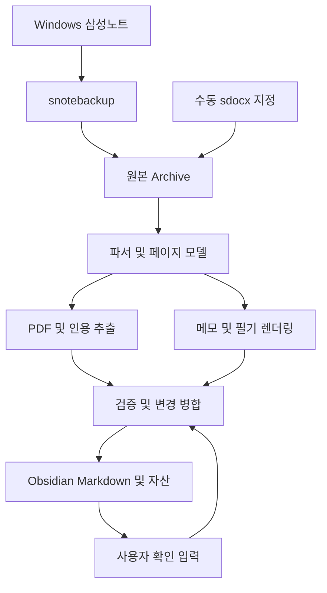

# Samsung Notes → Obsidian 자동 연동 개발 계획

작성일: 2026-10-08 · 갱신일: 2026-10-13 · 상태: 샘플 3개 구조 조사 수행 / 인용 품질·제품 구현 전

관련 문서: [백로그](02_backlog.md) · [검증 계획](03_verification.md)

실제 샘플의 최신 관측과 제한은 [구조 조사 결과](../../05_structure_research.md)에 기록한다. 아래 정책은 유지하며 일부 추출 성공을 품질 관문 통과로 간주하지 않는다.

## 1. 목표

삼성노트에서 PDF를 읽으며 표시한 원문, 작성한 텍스트 메모, 손필기를 Obsidian에 모은다. 삼성노트에 가져온 PDF 사본 하나당 Markdown 하나를 만들고 페이지별로 내용을 구성한다. 이후 삼성노트의 변경을 자동 영역에 반영하면서 Obsidian에서 사용자가 직접 작성한 내용은 보존한다.

주요 사용자는 개발자 본인이 아닌 실제 자료 독자다. Zotero는 사용하지 않으며, Zotero Integration은 인용·메모를 가져오는 사용 경험의 참고 사례일 뿐이다.

성공 기준은 대부분의 인용이 수동 수정 없이 추출되는 것이다. 자동화 구축 전에 실제 샘플로 추출 품질을 검증한다.

## 2. 범위와 확정 정책

| 항목 | 첫 버전 정책 |
| --- | --- |
| 입력 | 지정 삼성노트 폴더 및 하위 폴더의 백업, 직접 지정한 하나 이상의 `.sdocx` |
| 기본 단위 | 삼성노트 하나에 PDF 하나인 경우. 동일 PDF를 다른 노트로 등록하면 별도 관리 |
| 자동 인용 | 텍스트가 있는 PDF의 밑줄·하이라이트. 선택형 표시와 펜 표시를 별도 평가 |
| 펜 표시 대안 | 품질 기준 미달 시 수동 확인으로 전환 가능. 실제 사용성은 재평가 |
| 기타 표시 | 동그라미·화살표·괄호는 자동 원문 추출 대상에서 제외하고 이미지 보존 |
| 사용자 텍스트 | 해당 페이지의 타이핑 및 손필기 변환 텍스트를 모두 수집. 질문/요약 분류 안 함 |
| 미변환 손필기 | OCR 없이 PDF 배경을 포함한 페이지 전체 이미지로 표시 |
| 대응 관계 | 페이지별 집계만 수행. 개별 인용과 개별 메모를 자동 연결하지 않음 |
| 출처 | 내장 원본 PDF 회수 후 Vault에 보관하고 해당 페이지로 연결 |
| PDF 출력 | 필기가 합쳐진 새 PDF를 만들지 않음 |
| 갱신 | 자동 영역은 최신 상태, 사용자 글은 항상 보존 |
| AI | 외부 AI API 일체 사용 안 함. 현재 범위에 AI 의존성 없음 |
| 자동 실행 | PC 가동·소스 접근 가능 시 30분 간격, 수동 바로가기 지원 |
| 백업 | 최신 `.sdocx`와 변경 전 버전 30일 보관 |

스캔 PDF는 자동 OCR 없이 수동 확인 대상으로 둔다. 페이지 추가·삭제·재배열 지원은 후순위다. 해당 변화가 감지되면 잘못된 출처를 생성하지 않도록 영향받는 처리를 보류한다.

## 3. 기술 전제와 검증 상태

다음은 합의한 요구사항과 달리 아직 구현 사실로 확정되지 않았다.

| 가정 | 현재 상태 | 확인 방법 |
| --- | --- | --- |
| Windows 삼성노트 동기화 사용 가능 | 운영 전제로 가정 | 실제 PC에서 태블릿 수정 반영 확인 |
| `.sdocx`에서 원본 PDF 회수 가능 | 샘플 3개 내장 PDF 회수 성공. 가져오기 전 원본 동일성은 미확인 | 비교용 원본 PDF와 비교 |
| PDF 페이지와 삼성노트 페이지 연결 가능 | PDF 배경 68개 참조 해석. PDF 없는 중간 노트 페이지 1개 관측 | 삼성노트 기준 화면과 대응 확인 |
| 선택형 하이라이트를 식별 가능 | 미검증 | 실제 저장 객체/좌표 조사 |
| 펜 밑줄과 원문 연결 가능 | 미검증 | 좌표 변환 및 문장 범위 평가 |
| UUID 및 페이지 식별 안정성 | 노트 UUID 확보 실패. 페이지 UUID는 관측, 안정성 미검증 | 이름 변경·수정·백업 반복 비교 |
| 필기 렌더링이 실사용 수준 | PNG 5장 생성, 도형 8개 누락 확인. 실사용 품질 미검증 | 누락 처리 및 삼성노트 화면과 비교 |

내장 PDF를 찾지 못하면 텍스트·이미지로 재구성한 PDF를 원본으로 취급하지 않는다. 샘플 결과를 보고 입력 경로 또는 범위를 다시 결정한다.

## 4. 참고 프로젝트와 재사용 전략

| 프로젝트 | 활용 목적 | 주의점 |
| --- | --- | --- |
| [snotebackup](https://github.com/enyx24/snotebackup) | Windows 데이터에서 `.sdocx` 백업, UUID·변경·삭제 정보 수집 | 삼성노트 내부 DB/폴더와 백업 산출물은 별개. 실제 동작 검증 필요 |
| [Dietrich](https://github.com/Downhillghost/Dietrich) | 텍스트·필기·PDF 배경·중간 모델·PNG 렌더링을 우선 검토 | README의 지원 설명이 원본 PDF의 완전한 회수를 보증하지 않음 |
| [sdocx_parser](https://github.com/0xA01F3/sdocx_parser) | 텍스트 서식 및 바이너리 구조 참고 | 재사용 전 현재 라이선스와 적용 범위 확인 |
| [Windows-Samsung-Notes-Markdown-Exporter](https://github.com/joshua1955/Windows-Samsung-Notes-Markdown-Exporter) | Windows DB·미디어 관계 및 기존 변환 방식 참고 | 필수 의존성으로 확정하지 않음 |

Dietrich의 기존 모델로 필요한 정보를 얻을 수 있는지 먼저 확인한다. 독자 Parser 전체를 처음부터 작성하지 않고, 부족한 의미 해석과 Markdown 출력을 어댑터로 추가하는 방향을 우선한다. 구현 시작 시 사용 커밋·버전과 라이선스를 기록한다.

## 5. 전체 데이터 흐름



Obsidian API 없이 Vault 파일을 직접 갱신한다. 이후 기기간 동기화는 사용자의 기존 Obsidian 동기화 수단에 맡긴다. 이 개발 범위는 로컬 Vault까지이며, 다른 기기에서 편집한 파일이 뒤늦게 도착할 가능성을 고려해 쓰기 직전 변경 여부를 확인한다.

## 6. 저장 구조와 식별

아래 경로와 내부 파일명은 구현 제안이다.

```text
SamsungNotesArchive/
  raw/<note_uuid>/latest.sdocx
  history/<note_uuid>/<version>.sdocx
  state.sqlite

Vault/
  Samsung Notes/<최초 소스 폴더>/<제목>.md
  Samsung Notes/assets/<note_uuid>/source.pdf
  Samsung Notes/assets/<note_uuid>/<page_key>.png
```

- 노트의 primary key는 삼성노트 UUID다. 제목이나 PDF 해시만으로 합치지 않는다.
- 수동 import 후 같은 UUID가 자동 소스에서 확인되면 기존 Markdown에 연결한다.
- UUID가 없거나 신뢰할 수 없으면 임시 식별자로 격리하고 수동 연결을 요청한다.
- 같은 UUID의 서로 다른 버전이 동시에 주어지면 파일 선택 순서만으로 최신본을 판단하지 않는다.
- 최초 생성 때 소스 폴더·제목을 따른다. 이후 사용자가 변경한 Markdown 파일명·위치를 유지한다.
- 경로 매핑이 틀리면 frontmatter UUID로 재탐색한다. 같은 UUID의 Markdown이 둘 이상이면 갱신을 보류한다.
- 사용자 파일 이동 후 PDF·이미지 상대 링크도 새 위치에 맞춰 검증한다.
- 페이지 식별자는 안정성이 확인된 페이지 UUID를 우선 사용한다. 화면에 보이는 페이지 번호를 영구 식별자로 가정하지 않는다.

상태 저장소에는 소스 버전/해시, PDF·페이지 매핑, 출력 경로, 마지막 생성 영역 본문 또는 비교용 해시, 수동 확인 결과와 그 근거 버전, 갱신 상태를 저장한다.

## 7. 중간 모델

PDF 주석 수집에 필요한 최소 모델을 사용한다.

```text
Note
  identity / source metadata / source revision
  original PDF asset
  Pages[]
    page key / original PDF page index
    marks[]: type, geometry, source fingerprint
    quotes[]: text, provenance, review status
    user text[]: text, source object
    handwriting / page preview asset
```

PDF 본문과 사용자가 작성한 텍스트를 구분한다. 손필기에서 변환한 텍스트와 남아 있는 획은 임의로 중복 제거하지 않는다. 원문-메모 간 의미적 연결이나 자동 요약은 만들지 않는다.

## 8. 인용 추출과 수동 확인

1. PDF 텍스트와 좌표를 읽고 노트 표시 좌표와 맞춘다.
2. 선택형 표시와 펜 표시를 각각 해석한다.
3. 문장 범위가 애매하거나 텍스트를 얻지 못하면 `확인 필요`로 보낸다.
4. 페이지의 타이핑·변환 텍스트를 모은다.
5. 손필기가 있는 페이지는 배경을 포함해 PNG 미리보기를 생성한다.

확인이 필요한 페이지는 기존 자동 결과를 유지하고 오래된 결과임을 명시한다. 처음 가져오는 페이지에는 출처와 대기 상태를 남긴다. 정상 페이지는 같은 Markdown 안에서 먼저 갱신할 수 있다.

사용자는 Obsidian의 지정 입력 영역에 원문을 복사·붙여넣고 완료 표시를 한다. 프로그램은 다음 실행에서 이를 읽어 반영한다. 이 입력은 사용자 소유 데이터로 보존하며 자동 영역의 임의 수정과 구별한다. 관련 표시 또는 원본이 바뀌면 다시 확인 대상으로 전환하고, 이전 입력은 참고용으로 남긴다. 변경 영향 범위를 확정할 수 없으면 해당 페이지 단위로 재확인한다.

## 9. Markdown 템플릿과 사용자 글 보호

아래는 인터페이스 초안이며 세부 마커 문법은 구현 중 확정한다.

```markdown
---
source: samsung-notes
samsung_uuid: NOTE_UUID
samsung_title: 원래 제목
samsung_folder: 연구/논문
---

# 논문 제목

## PDF 7페이지

<!-- sn:auto:start page=PAGE_KEY -->
[원본 PDF 7페이지](assets/NOTE_UUID/source.pdf#page=7)

> 표시한 원문

사용자 메모: 삼성노트에서 작성한 텍스트


<!-- sn:auto:end page=PAGE_KEY -->

<!-- sn:review:start page=PAGE_KEY -->
- [ ] 확인 완료
수동 인용문:
<!-- sn:review:end page=PAGE_KEY -->

### 내 생각
이 영역에는 사용자가 자유롭게 작성한다.
```

Quote 문법 자체를 소유권 경계로 삼지 않는다. 생성 영역 마커와 마지막 생성 결과를 비교해 수정 여부를 감지한다. 마커 밖의 내용, 수동 확인 입력, 사용자 frontmatter는 보존한다.

자동 영역을 사용자가 수정한 경우 덮어쓰지 않고 해당 파일 갱신을 멈춘다. Git 충돌 안내처럼 문제 영역에 이유와 해결 안내를 추가한다. 마커 훼손으로 경계를 식별할 수 없으면 파일 상단에 안내한다. 안내 추가 전에도 파일 변경 여부를 확인하며 동일 안내를 반복 삽입하지 않는다. 기존 사용자 내용을 충돌 후보 텍스트로 대체하지 않는다.

사용자가 수정분을 개인 메모 영역으로 옮기고 명시적으로 해결한 뒤 자동 갱신을 재개하도록 한다. 자동 영역 안의 사용자 수정도 보존 대상이다.

## 10. 변경·삭제·실패 정책

| 상황 | 처리 |
| --- | --- |
| 변경 없음 | 파일·동기화 시각을 불필요하게 다시 쓰지 않음 |
| 정상 소스 변경 | 변경된 페이지와 자산만 처리 |
| 인용 수동 확인 필요 | 해당 페이지 결과 보류, 다른 페이지 갱신 |
| 사용자 수정 충돌/마커 훼손 | 해당 Markdown 전체 갱신 중단, 다른 파일 계속 처리 |
| 소스 삭제/대상 폴더 이탈 | Markdown·자산·사용자 글 유지, 갱신 제외 표시 |
| 소스 접속 실패 | 삭제로 판단하지 않고 재시도 상태 기록 |
| 페이지 구조 변경 | 출처 대응을 신뢰할 수 없는 부분 보류, 지원 외 상태 표시 |
| PDF 없음/여러 PDF 등 미지원 구조 | 임의 병합 없이 사유 표시 |
| 변환 실패 | 원본과 마지막 성공 출력 유지, 성공 상태를 앞당겨 기록하지 않음 |

수정 전 파일 해시 재확인, 임시 파일 작성 후 교체, 실행 중복 방지, 자산 준비 후 Markdown 반영을 사용한다. 이전 정상 결과가 참조하는 자산은 실패 중 삭제하지 않는다. 원본 백업 성공과 출력 갱신 성공은 각각 기록한다.

## 11. 백업 및 실행

- 최신 원본은 계속 유지한다. 변경 전 버전은 보관 시작 시점부터 30일 유지한다.
- 변경 없는 파일은 이력으로 중복 적재하지 않는다.
- 최신 원본과 삭제된 소스의 마지막 원본을 단순히 30일이 지났다는 이유로 삭제하지 않는다.
- 저장 용량과 최초 처리 시간은 샘플 기반으로 측정한다. 아직 용량·성능 보장은 없다.
- 30분 증분 실행과 수동 바로가기를 제공한다. PC가 꺼져 있으면 실행되지 않는다.
- 원안의 하루 1회 full reconcile은 구현 기본안으로 유지하되 실제 snotebackup 동작과 비용을 검증한다.
- 실행 결과에는 성공·확인 필요·충돌·실패·갱신 제외 건수를 보여준다.

## 12. 개발 단계와 종료 조건

| 단계 | 작업 | 다음 단계 진입 조건 |
| --- | --- | --- |
| 0. 샘플 확보 | 실제 표시 유형·원본 화면·sdocx 수집 | 정답과 비교 가능한 샘플 확보 |
| 1. 추출 실험 | PDF 회수, 페이지 대응, 텍스트/표시/필기 파싱 | 핵심 기술 전제 확인 |
| 2. 품질 관문 | 최소 50개 표시 평가 | 검증 문서의 자동 추출 기준 통과 또는 범위 재합의 |
| 3. 단일 파일 MVP | 템플릿, 원본 PDF 링크, PNG, 수동 확인 | 한 노트의 읽기·확인 흐름 사용 가능 |
| 4. 안전한 갱신 | UUID, 사용자 글 보호, 충돌, 삭제, 이력 | 보호·실패 복구 테스트 통과 |
| 5. 자동 실행 | 폴더 선택, 증분, 수동 import, 바로가기 | 실제 사용 환경에서 end-to-end 확인 |

샘플 3개의 구조 조사를 수행했으나 정답 라벨과 원본 화면 비교는 아직 없다. 인용 품질 관문을 통과했다고 기록하지 않는다. 확정 범위 밖의 확장은 백로그에서 별도로 관리한다.
